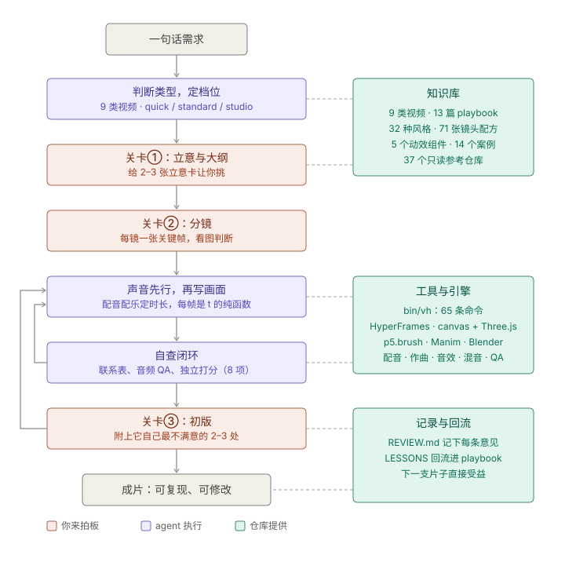

<div align="center">

# OpenVideoHarness

**给 Claude Code、Codex 用的做视频工作台：一句话提需求，agent 写代码渲染出每一帧，自己检查，在三个节点停下来等你拍板。**

科普短视频、3Blue1Brown 式讲解、发布片、MV、数据故事、论文讲解、手绘短片、梗图快剪，都能配音，配乐和音效也用代码写。

[English](README.md) · **中文** · [官网](https://zlhad.top/OpenVideoHarness/docs/site/?lang=zh) · [Wiki](https://github.com/ZLHad/OpenVideoHarness/wiki)


<a href="showcase/"></a>

<sub>5 支样片和风格库里的画面。每一支都是 agent 只照着本仓库的文档做出来的。</sub>

</div>

---

## 能做出什么

[`showcase/`](showcase/) 里每支片子一个目录，放着需求、Brief、分镜、审阅记录和全部源码，可以直接拿来当同类片子的起点。

https://github.com/user-attachments/assets/48923404-eff1-41cd-b303-82c9ede51c1f

<sub>▶ 介绍片的开场（25 秒，有声音），用代码驱动 Blender 路径追踪渲出来。整支片子是下表第一行。</sub>

<table>
<tr>
<td width="38%" valign="top"><a href="showcase/04-intro-film/README.zh-CN.md"></a></td>
<td valign="top"><b><a href="showcase/04-intro-film/README.zh-CN.md">04 · 介绍片</a></b><br><sub>Blender + HyperFrames + Three.js · 103 秒 · 1920×1080 · 精品档</sub><br>本仓库自己的产品片。118 万颗星组成的星系用 Blender 路径追踪渲出来，坍缩、压平成一片影片之海；之后一个连续的 3D 长镜头，跟着一句需求走完整个仓库。<br><b><a href="showcase/04-intro-film/README.zh-CN.md#你说了什么原话">需求</a>（关卡 ① 上的原话）：</b>"玻璃、宇宙、星穹……令人瘫坐眩晕的感觉"<br><sub><a href="https://github.com/ZLHad/OpenVideoHarness/releases/download/media/intro-film-1080p.mp4">1080p 原片（297 MB）</a> · <a href="https://github.com/ZLHad/OpenVideoHarness/releases/download/media/intro-film-4k.mp4">4K（1.04 GB）</a></sub></td>
</tr>
<tr>
<td width="38%" valign="top"><a href="showcase/02-short-leo-doppler/"></a></td>
<td valign="top"><b><a href="showcase/02-short-leo-doppler/">02 · 竖屏科普</a></b><br><sub>HyperFrames · 24.8 秒 · 1080×1920</sub><br>低轨卫星的信号为什么会"变调"，关掉声音也看得懂。中文配音，中英字幕。<br><b><a href="showcase/02-short-leo-doppler/README.md#the-request-this-was-built-from">需求</a>：</b>"为什么低轨卫星的信号会'变调'？——多普勒频移"<br><sub><a href="https://github.com/ZLHad/OpenVideoHarness/releases/download/media/02-vertical-science-short.mp4">原片（6.0 MB）</a></sub></td>
</tr>
<tr>
<td width="38%" valign="top"><a href="showcase/03-math-fourier/"></a></td>
<td valign="top"><b><a href="showcase/03-math-fourier/">03 · 3Blue1Brown 式数学讲解</a></b><br><sub>Manim · 25 秒 · 1920×1080</sub><br>正弦波一层层叠成方波，最后停在吉布斯过冲上。英文旁白，每个谐波有自己的音。<br><b><a href="showcase/03-math-fourier/README.md#the-request-this-was-built-from">需求</a>：</b>"Building a square wave from sine waves"（用正弦波拼出方波）<br><sub><a href="https://github.com/ZLHad/OpenVideoHarness/releases/download/media/03-math-explainer.mp4">原片（2.9 MB）</a></sub></td>
</tr>
<tr>
<td width="38%" valign="top"><a href="showcase/01-handdrawn-clawd-leaf/"></a></td>
<td valign="top"><b><a href="showcase/01-handdrawn-clawd-leaf/">01 · 手绘角色短片</a></b><br><sub>p5.brush · 12 秒 · 1920×1080</sub><br>没有字、没有旁白的三镜头默剧，配乐和拟音跟着每个动作走。<br><b><a href="showcase/01-handdrawn-clawd-leaf/README.md#the-request-this-was-built-from">需求</a>：</b>"Clawd tries to film a falling autumn leaf with a tiny hand-cranked movie camera; the wind keeps snatching the leaf just as Clawd frames it …"（Clawd 用手摇小摄影机拍一片落叶，风总在它对准的时候把叶子抢走……）<br><sub><a href="https://github.com/ZLHad/OpenVideoHarness/releases/download/media/01-handdrawn-short.mp4">原片（9.0 MB）</a></sub></td>
</tr>
<tr>
<td width="38%" valign="top"><a href="showcase/00-promo-launch-film/"></a></td>
<td valign="top"><b><a href="showcase/00-promo-launch-film/">00 · 发布短片</a></b><br><sub>HyperFrames · 20 秒 · 1920×1080</sub><br>用这个仓库自己的终端、路由表和联系表搭成，画面上每个动作都有音效。<br><b><a href="showcase/00-promo-launch-film/README.md#the-request">需求</a>：</b>"Produce the README hero video — a short launch film for OpenVideoHarness itself …"（做 README 首屏的主视频：一支给 OpenVideoHarness 本身的发布短片……）<br><sub><a href="https://github.com/ZLHad/OpenVideoHarness/releases/download/media/00-launch-short.mp4">原片（6.8 MB）</a></sub></td>
</tr>
<tr>
<td width="38%" valign="top"><a href="styles/"></a></td>
<td valign="top"><b><a href="styles/">风格连播</a></b><br><sub>32 种风格 · 每种约 1.5 秒</sub><br>同一段内容，用风格库里的每一种风格各渲一遍，每种配自己的音乐。<br><sub><a href="https://github.com/ZLHad/OpenVideoHarness/releases/download/media/styles-gallery-v2.mp4">原片（7.9 MB）</a></sub></td>
</tr>
</table>

片子都放在 [Release `media`](https://github.com/ZLHad/OpenVideoHarness/releases/tag/media) 里，不进 git，克隆仓库不用下载它们。00–03 这四支先做成无声片，声音是后来配上的。社区里的同类作品和我们的拆解在 [`cases/`](cases/README.md)；你用本仓库做出的片子，也欢迎 PR 进 `showcase/`。

## 快速开始

需要 macOS 或 Linux、Node.js ≥ 22、Google Chrome、FFmpeg、Python 3 和 [uv](https://github.com/astral-sh/uv)，以及 Claude Code 或 Codex（[完整的要求](#要求成本和限制)）。

```bash
curl -fsSL https://raw.githubusercontent.com/ZLHad/OpenVideoHarness/main/install.sh | bash
cd ~/OpenVideoHarness && claude        # 或者 codex
```

安装脚本把仓库装到 `~/OpenVideoHarness`，装好依赖，拉取 37 个只读的参考仓库，并把 `open-video-harness` skill 注册给 Claude Code 和 Codex，之后在任何目录说"做个视频"，agent 都能找到这里。一共占约 650 MB 磁盘。然后直接说你要什么：

> 做一个 30 秒的竖屏科普：为什么低轨卫星的信号会"变调"。中文配音，中英双语字幕。

接下来它会：

1. 先给两三个创意方向，每个配一帧画面和一个开头钩子，附一份大纲，等你选；
2. 再给分镜，每个镜头一张关键帧；
3. 最后给初版，附上评审分数和它自己最不满意的两三处。

你点了头，它才出成片。从零走到第一支片子的完整过程，见 wiki 的[快速开始](https://github.com/ZLHad/OpenVideoHarness/wiki/%E5%BF%AB%E9%80%9F%E5%BC%80%E5%A7%8B)。

说清楚讲什么、给谁看、发在哪就够了，不用写长篇 brief：

| 想做 | 这样说 |
|---|---|
| 数学讲解 | "3Blue1Brown 那种风格，讲傅里叶级数怎么一点点拼出方波，20 秒，静音也能看懂。" |
| 产品片 | "给我的 App 做一支 30 秒发布片，用水墨风格，只用真实截图，关键动作配音效。" |
| 论文讲解 | "把 `papers/main.tex` 的核心方法做成 3 分钟讲解，论文信息照抄原文，英文旁白加中文字幕。" |
| 资料片 | "用 NASA 公有领域的发射影像剪一支 40 秒的倒计时短片，每段素材的许可都记下来。" |
| 快速试一版 | "快速出一版 15 秒的草稿，看看赛博故障风适不适合我的游戏预告，不用问我。" |
| 深度参与 | "做一支 90 秒的知识视频，讲卫星怎么避免相撞，要精品。开头钩子、主角、主旋律、标题和封面我来定，其余你定。" |

## 它怎么工作

现在让 AI"一句话做一支视频"已经不稀奇，难的是每次都做好。同一个模型，这次惊艳，下次就节奏乱、满屏发光、数字乱编，因为它手里没有一套做片子的流程，也没法检查自己的活。这个仓库就是这套流程和检查办法，写成 agent 能照着做的文档和一个命令行工具 `bin/vh`。

<p align="center"></p>

片子就是代码。agent 写一个页面（或一段 Manim 场景、一个 Blender 脚本），里面每一帧都是时间 t 的函数；浏览器（或 Manim、Blender）逐帧画出来，FFmpeg 再接上音轨。agent 看不了视频、听不了声音，所以每一步都做成能从帧、数据和文字上检查。

1. **判断类型**：按 [CLAUDE.md](CLAUDE.md) 的路由表，定下是 9 类视频里的哪一类、照哪份工作流做；做多认真、哪些事你要亲自定，按你的需求来。
2. **关卡 ①：立意和大纲**：两三张立意卡，每张配一帧画面和一个钩子。选定一张，立意、画面风格和钩子就一起定了，这时还没写一行代码。
3. **关卡 ②：分镜**：每个镜头写清观众要依次看懂什么、各占几秒，每镜一张关键帧。
4. **声音先行**：先做旁白或配乐，量出每个字、每一拍的时间，画面挂在这些时间上。
5. **写代码，自己查**：每写完一段，把帧拼成联系表，对着 20 条的清单改，再用数据查声音；整片 draft 交给一个全新上下文的 reviewer，按 8 项打分。
6. **关卡 ③：初版**：给你看初版、联系表、评审分数和它最不满意的地方。你说不清哪里不对时，它把同一段做成两三个版本让你挑。
7. **出片**：成片过一遍 `bin/vh check`，这次踩的坑写进项目的 `LESSONS.md`。

几条从不放松的规则（完整版见 [CLAUDE.md](CLAUDE.md)）：每一帧只由 t 决定，所以任何一帧都能单独渲、并行渲、乱序渲，也能抽查；有声音时声音定时长；先分镜后代码；数字、引文、论文信息照抄原文，拿不准的不编进片子；API key 只放在环境变量里。

**和直接让 AI 做有什么不同？** 我们做过一次小的盲评（[docs/research/06](docs/research/06-concept-first-ab.md)）：两条一句话需求，各按流程（快出档）做一支、只给几条底线做一支，都是无声片。按流程做的点子更新，但评审觉得只守底线的那两支做得更好，两次都选了它们去发；两边的耗时和 token 差不多。评审指出的问题（字在手机上太小、开头太慢）后来都变成了检查。流程想省的是返工：方向在写代码前定，问题在出片前查；这一点还没有量过。

## 工具一览

工具跟着做片子的顺序走：想、找料、做、查和交付。下表每个名字都是一条 `bin/vh` 命令；`bin/vh commands` 按流程阶段列出全部 65 条命令，每条命令加 `-h` 看用法。

| | 命令 | 做什么 |
|---|---|---|
| **想** | `know` | 仓库里关于几个词已经有什么（配方、组件、风格、playbook 的某一节、案例），不用先读文档 |
| | `scout` | 选题前看一个题目在各平台上的样子（头部视频和其中的异类、热榜），片子发出去以后看它的数据；只用公开接口，不登录 |
| | `ref` | 把参考的视频、帖子、图片、网页记下来：从哪来、什么许可、为什么参考它 |
| | `breakdown` | 拆一支参考片：切点和转场落在节拍的哪里、关键帧、可以换掉什么 |
| | `concept` | 立意卡的可选配件：按项目名抽取框架的"轮盘"，以及"六选三"页 |
| **找料** | `footage` | 从 Internet Archive、Wikimedia Commons 和 NASA 取真实影像，只取要用的几秒，每段的许可都记进台账 |
| | `image` | 用 Gemini 的 Nano Banana 或 Codex 的 image_gen 生成图：先估价，每次付费调用先按项目预算占住；也能抠出透明图 |
| | `sfx` · `bgm` · `sound` | 从你自己的声音库和 Openverse 里找录好的音效、有许可的配乐，连同署名一起取进项目 |
| | `cast` | 项目里的角色、服装、道具和场景，定稿的参考图各放一个目录，`image gen --ref cast:<id>` 会带上它们 |
| | `model3d` · `hdri` | 3D 模型放进来之前先读一遍；从 Poly Haven 取 CC0 的环境贴图给它打光 |
| | `assets` | 片子用到的每个文件记在一本台账里：从哪来、什么许可、花了多少钱；交付前 `check`、出 `credits` |
| **做** | `new` | 按模板建项目，大多数类型会一起搭好引擎 |
| | `style` · `recipes` · `components` | 风格预设、镜头配方和镜头语法卡、动效组件 |
| | `edit` | 把片子写成剪辑表：页面、图片、实拍素材、别的片子和声音排成一列 |
| | `tts` · `music` · `captions` · `mix` | 配音、用代码写的配乐、字幕、混音（见[声音](#声音)） |
| **查和交付** | `gate` · `desk` | 一条命令停下来等你拍板；审阅台可以逐条勾选、点评 |
| | `frames` · `sheet` · `determinism` | 无损取帧、联系表，以及查每一帧是不是真的只由 t 决定 |
| | `check` | 对着 Brief 查成片：黑场、定格、静音、闪烁、字幕、色彩标记、响度 |
| | `render` | 分块并行渲 MP4，中断了能续渲，每次渲染都留一个版本 |
| | `patch` · `versions` | 只重画成片里的几秒；对比各版渲染，或者退回某一版 |
| | `deliver` · `clean` | 出上传用的版本；清掉做完的项目里的中间文件 |

`bin/vh doctor` 读 `tools/modules.json`，告诉你这台机器能用上 39 个外接模块（程序、包、模型和联网服务）里的哪些。

## 引擎、类型和素材库

### 引擎

它不是渲染引擎，而是架在这些引擎之上，告诉 agent 怎么用好它们：

| 引擎 | 画什么 | 用在哪 |
|---|---|---|
| [HyperFrames](engines/README.md#hyperframeshtml--gsap)（HTML + GSAP） | 有真实字体和排版的页面；还有一个现成积木的注册表（`bin/vh hf`） | 科普短视频、产品片、数据故事、梗图快剪、风格样片 |
| [canvas-film](engines/canvas-film/README.md)（canvas 2D），可选 Three.js 层 | 旁白撑着的长片：镜头、字幕、章节进度条都挂在旁白的字上；GLB 模型和它的动作画在 2D 下面 | 任何类型（`--engine canvas-film`；加 `--three` 带上 3D 层） |
| [ClaudeAnimationBase](engines/ClaudeAnimationBase/)（p5.js + p5.brush），自带 | 手绘线条、水彩、角色 | 手绘短片、MV |
| Manim CE，可选更快的后端 [ManimGX](engines/manimgx.md) | 数学和机制 | 数学、科学讲解，论文讲解 |
| [Blender](engines/blender.md) 5.2，可选 | 路径追踪的光影、物理、真实景深；或者把 3D 资产整理好交给 Three.js 层 | 网页引擎做不到的镜头 |

Remotion 在几份类型文档里列为备选，没有样片用它，要手动初始化（见 [engines/README.md](engines/README.md)）。

### 视频类型

| 类型 | 适合做什么 | 首选引擎 | 文档 |
|---|---|---|---|
| 01 数学、科学讲解 | 3Blue1Brown 式的原理动画 | Manim | [01](video-types/01-math-science-explainer.md) |
| 02 知识科普短视频 | 抖音、B 站、小红书、视频号、Shorts | HyperFrames | [02](video-types/02-knowledge-short.md) |
| 03 产品片、发布片 | App、SaaS、开源项目的介绍和功能演示 | HyperFrames | [03](video-types/03-product-promo.md) |
| 04 歌词视频、MV | 跟着音乐走的动画 | p5.brush 或 HyperFrames | [04](video-types/04-lyric-music-video.md) |
| 05 数据故事 | 动态图表、数字可视化 | HyperFrames + SVG | [05](video-types/05-data-story.md) |
| 06 论文讲解 | 会议视频、学术报告 | Manim 或 HyperFrames | [06](video-types/06-paper-explainer.md) |
| 07 手绘短片 | 水彩、白板、剪纸、角色小短片，能按笔顺写汉字 | p5.brush（自带） | [07](video-types/07-hand-drawn.md) |
| 08 梗图快剪 | 野兽派、科技推特风 | HyperFrames | [08](video-types/08-brutalist-meme.md) |
| 09 剪你自己的素材（试验中） | 口播、访谈：删口水词、加字幕和图解、出竖屏版 | HyperFrames | [09](video-types/09-editing-talking-head.md) |

要写实人物或真实物理时，接生成式视频再用代码叠加（[playbook/05](playbook/05-hybrid-genvideo.md)）；讲有起伏的故事或 3 分钟以上的长片看 [playbook/09](playbook/09-narrative.md)；开头钩子、标题和封面看 [playbook/10](playbook/10-hooks-and-packaging.md)。

### 风格

AI 做的视频放着不管，很容易长成一个样子：暗底、发光、玻璃卡片。[`styles/`](styles/README.md) 收了 32 种从名作里提炼的风格：Saul Bass 的片头、瑞士网格、3Blue1Brown、《纽约时报》的数据图、《蜘蛛侠：平行宇宙》的网点、韦斯·安德森的对称构图、水墨、敦煌、皮影、国潮等。每种都写清颜色、字体、构图、运动、转场和声音，并用同一段内容实际渲染了一段 5 秒样片：

<a href="styles/"></a>

风格是参考，不是模板：可以借一种、借几种，也可以完全不借。学的是视觉语法，不用原作的角色、logo 和镜头。`bin/vh style list` 看全部，`bin/vh new promo launch-film --style cutout-jazz` 给项目挂一种当参考。

### 配方、镜头语法卡、组件

- **[配方](recipes/README.md)**：71 张镜头配方（一个镜头或一个接缝怎么动：分几段、每段多少帧、哪些参数不能降、在哪容易翻车），另有 10 条全片骨架（整支片子的能量弧和停顿预算）。`bin/vh recipes list --intent … --energy …` 按意图和能量筛；写了代码草图的配方都带一张实渲的样片联系表。
- **镜头语法卡**：`recipes/shot/` 里有 24 张镜头语法卡，讲景别、角度、轴线和运镜，每张写它对观众起什么作用、什么时候用、什么时候别用。选定的写进镜头表的 `camera`，`bin/vh storyboard` 会印在镜头下面。
- **[组件](components/README.md)**：5 个动效组件（弹簧场景、翻页、纸面转场、章节进度条、一块块搭起来的建筑），每个都由 t 算出状态，再用很薄的一层画进 canvas、DOM 或 Three.js。`bin/vh components add` 把它复制进项目。

这些都是起步用的默认做法，不是规则：立意需要别的做法，直接做就行。

## 声音

AI 听不见，所以声音尽量做成能计算、能测量的。

- **配音**（`bin/vh tts`）：默认是本地开源的 Qwen3-TTS，在 Apple Silicon 上离线免费，中文 5 个音色、英文 2 个。云端可以接 Gemini、MiniMax、ElevenLabs、阿里云百炼，还有 Edge 的在线音色，打草稿可以用 macOS 自带的 `say`。加 `--align` 能拿到逐字时间，字幕和画面可以挂在某个字上。
- **字幕**（`bin/vh captions`）：旁白稿写成 `中文 || English`，出中文、英文或双行字幕，烧进画面或做成可开关的字幕轨。
- **配乐**（`bin/vh music`）：用代码作曲，同一份谱永远生成同一段音乐，并给出每一拍的时间让画面卡点；有类编钟、古筝、笛子这些中国乐器。用你自己的曲子时，`bin/vh beats` 分析节拍；`bin/vh bgm` 在 Openverse 找一首 CC 许可的曲子，在强拍上截好；`bin/vh music --provider lyria` 用 Google 的 Lyria 生成一首（按首付费，先按预算占住，记进台账、标成 AI 生成）。
- **音效**（`bin/vh sfx`）：21 个用代码合成的音效，摆在动作发生的那一帧；每支片子按自己的顺序取变体，重复的音效听着不一样。也能用录好的，来自你自己的声音库和 Openverse 上 CC0、CC BY 的音效，许可和署名都记下来。
- **混音和质检**（`bin/vh mix`、`bin/vh qa`）：有旁白时音乐自动让开，整体响度按 −14 LUFS；`qa` 查断音、掉音、忽大忽小、爆音，以及偏了不止一帧的卡点。机器判断不了的，`qa --listen 5` 剪出几段让人戴耳机听。

详见 [playbook/04-audio.md](playbook/04-audio.md)。

## 3D

有些镜头网页给不了：真玻璃的折射、体积光、真实的景深、上百万个粒子。这时 agent 写 Python 驱动 Blender。介绍片的开场就是这样做的：numpy 算出 118 万颗星每一帧的位置，Cycles 路径追踪渲染，475 帧在 M3 Max 上按 1080p 渲了 1 小时 28 分。

<p align="center"></p>

- **旁白片里放 3D**：用 canvas-film 的 Three.js 层（`--three`），GLB 模型画在 2D 下面，动作按旁白的字放，每一帧都是 t 的函数。
- **模型放进来之前**：`bin/vh model3d check` 先读一遍，面数、贴图、骨骼、动作名和时长、以米计的尺寸；加 `--blender` 再在 Blender 里查面片打架、零件翻面。
- **打光**：`bin/vh hdri` 从 Poly Haven 取 CC0 的环境贴图，给场景打光、当背景。
- **Blender 只做资产**：不需要路径追踪的镜头，Blender 只负责整理、绑骨、导出模型，由 Three.js 层出片。
- **安全**：Blender 脚本运行时拿不到你的环境变量，也就拿不到 API key；在 macOS 上还套着不联网的沙箱。什么时候值得用、怎么接进片子，见 [engines/blender.md](engines/blender.md)（部分验证）。

## 剪辑表

一支片子不必是一个页面。`edit.json` 把它排成一列条目，每条按自己的方式画：一个页面（愿意的话一章一个引擎）、一张带推拉的图、一块颜色、还没做的灰卡、一段实拍素材、另一个项目的成片，再加几条声音轨。`bin/vh edit init` 把镜头表变成剪辑表，每个镜头先是一张按计划计时的灰卡，这就是关卡 ② 的全长 animatic；之后再把灰卡一张张换成真的。

`bin/vh render` 先解析剪辑表，在每个切点放关键帧，把渲好的每一块存起来，改动之后再渲，只画变了的条目。`bin/vh patch`、`check`、`deliver` 读的是同一份表，还留着灰卡的片子交付不了。任何页面，不管在不在剪辑表里，渲染时都能加 `--motion-blur N`（每帧由 N 个子帧平均而成，切点照样是硬切）或 `--alpha`（出透明底的片子，叠在实拍上）。格式见 [engines/EDIT.md](engines/EDIT.md)。

## 做多认真、谁来拍板

档位管的是中途停几次、审几轮，不管成片好坏：三档出的都是正式画质的成片。在需求里说"快速出一版""直接出，我不看"或"做成精品"，或者建项目时写 `--effort`。

| | 快出 `quick` | 标准 `standard`（默认） | 精品 `studio` |
|---|---|---|---|
| 适合 | 一句话直接出片 | 想在关卡上亲自拍板的正式视频 | 要多轮打磨的发布片、旗舰内容 |
| 停下来等你 | 不停 | 三次 | 三次，每张立意卡附一段 10–20 秒的草图，分镜附全长 animatic |
| 全新上下文的评审 | 不做 | 1 轮，修最重要的至多 3 处 | 3 到 10 轮，做工五项都要 7 分以上 |
| 30 秒的片子大概要 | 10–30 分钟 | 1–2 小时 | 3 小时以上 |

哪一档都不放松的：事实不编、有声片里没有突然的静音、画面不频闪、字不小于目标屏幕的下限、素材许可记清楚、没有预算不调付费接口。

除了档位，你还可以点名哪些事自己定：开头钩子、风格、主角、主旋律、配音、旁白稿、分镜、标题和封面。点了名的，它出几个选项等你挑；没点名的，它自己定，理由写进项目的 `DECISIONS.md`，你随时能改。每次停下来是一条命令（`bin/vh gate`），生成一个本地审阅页，第一屏只放要你定的事，图、动态分镜和配乐都能在浏览器里直接看、直接听。`studio` 档的停顿换成审阅台（`bin/vh desk`）：每一项都能标"可以 / 要改 / 有疑问"、写一句话，最后一次提交；agent 在后台等着，你一提交它就接着做，原话抄进 `REVIEW.md`。两种页面都有中英文，跟着你第一句话的语言走。

## 要求、成本和限制

| 需要 | 用来做什么 |
|---|---|
| macOS 或 Linux、git | 基础（Windows 没有测过） |
| Node.js ≥ 22、Google Chrome | 在浏览器里画帧 |
| FFmpeg | 编码、混音、检查 |
| Python 3 + [uv](https://github.com/astral-sh/uv) | 声音工具、联系表、Manim；依赖第一次用时装进 uv 的缓存 |
| Apple Silicon | 本地 Qwen3-TTS 配音和本地逐字对时（换云端配音就不需要） |
| LaTeX | Manim 里的公式 |
| Blender 5.2 | 只有路径追踪的镜头和整理 3D 模型才要；沙箱目前只在 macOS 上有 |

- **成本**：渲染、配乐、音效都在本地跑，不花钱。要花的是 agent 本身（Claude Code 或 Codex 的订阅或 API 用量），以及你选用的云端配音、生成图、生成音乐、生成式视频，按各家收费。付费调用要有预算（Brief 的 `Budget:`，或者 `LOCAL.md` 里的默认预算），调用前先按预算占住；key 一律从环境变量读。
- **时间**：30 秒的标准档片子大约 1–2 小时，大部分花在自查和返工上。
- **限制**：agent 看不了视频、听不了声音，只能看渲染出的帧、读声音的数据，所以最后一关还是要你看、你听；目前只在 macOS（Apple Silicon）上完整跑过；写实人物要靠生成式视频；第 09 类剪辑还在试验，没有用真实素材试过。

## 安装、更新和国内网络

```bash
bash install.sh --dir ~/code/OpenVideoHarness   # 装到别的位置
bash install.sh --no-refs                        # 先不拉参考仓库（之后用 references/fetch.sh 拉）
bash install.sh --no-skill                       # 不注册全局 skill
```

- 安装脚本只拉最新的一个提交（下载约 95 MB，占 197 MB 磁盘）；想参与贡献或翻历史，就正常 `git clone`，再运行 `bin/vh setup`。
- 更新：用同样的参数再运行一次安装命令；`LOCAL.md` 和 `projects/` 不动，要覆盖你改过的文件时会先停下来。
- 样片的视频不在 git 里，要在本地复现样片时运行 `tools/fetch_media.sh`，它从 Release 下载到脚本要的位置。
- 第一次渲染、第一次用声音工具时还会下载 Chrome、Python 依赖和配音模型，各有多大、放在哪里，见 wiki 的[快速开始](https://github.com/ZLHad/OpenVideoHarness/wiki/%E5%BF%AB%E9%80%9F%E5%BC%80%E5%A7%8B)。国内网络连不上 npm、PyPI、Hugging Face 或 Google Fonts 时，镜像设置见 wiki 的[国内网络](https://github.com/ZLHad/OpenVideoHarness/wiki/%E5%9B%BD%E5%86%85%E7%BD%91%E7%BB%9C)。

只装 skill：`npx skills add https://github.com/ZLHad/OpenVideoHarness --skill open-video-harness`。它只是一个指针，第一次用时会征得你同意，再把完整的工作台装好。

## 文档地图

| 想看 | 去哪 |
|---|---|
| agent 读的入口：路由表、档位、拍板规则、硬规则 | [CLAUDE.md](CLAUDE.md)（`AGENTS.md` 内容相同） |
| 每类视频的工作流 | [video-types/](video-types/) |
| 通用知识：流程、自查、运动设计、声音、特效、叙事、钩子、作曲、创意 | [playbook/](playbook/) |
| 风格、配方和镜头语法卡、组件 | [styles/](styles/README.md)、[recipes/](recipes/README.md)、[components/](components/README.md) |
| 引擎、页面合约、剪辑表 | [engines/](engines/README.md)、[CONTRACT.md](engines/CONTRACT.md)、[EDIT.md](engines/EDIT.md) |
| 社区作品的 14 个案例拆解，以及本仓库自己做的片子和全部过程记录 | [cases/](cases/README.md)、[showcase/](showcase/) |
| 我们量过什么、因此改了什么 | [docs/research/](docs/research/README.md) |
| 命令行 | `bin/vh commands`、`bin/vh help`，每条命令加 `-h` |
| 新手教程、排错、常见问题 | [Wiki](https://github.com/ZLHad/OpenVideoHarness/wiki) |

## 和其他项目的关系

| 项目 | 它是什么 | 这里的不同 |
|---|---|---|
| [Code2Video](https://github.com/showlab/Code2Video) | 用 Manim 做教学视频的研究管线 | 把"代码即视频"推广到多类视频，交给通用的 coding agent 执行 |
| [HyperFrames](https://github.com/heygen-com/hyperframes)、[Remotion](https://github.com/remotion-dev/skills) 的官方 skills | 单个引擎的用法 | 在引擎之上：选引擎、定流程、定审美、做自查 |
| [OpenMontage](https://github.com/calesthio/OpenMontage) | 全套 agent 视频制作系统 | 更轻：主要是 markdown、模板和一个命令行，任何 coding agent 都读得懂、改得动 |
| [归藏 product-video skill](https://github.com/op7418/guizang-product-video-skill) | 专做软件产品更新片 | 覆盖更多类型，有三次人工拍板、风格库和中英双语声音；配乐音效的思路受它启发，代码是独立写的 |

## 参与贡献

欢迎 PR：新的视频类型、带样片的风格、配方、组件、案例拆解、你在项目里总结出的通用经验，以及你用本仓库做出的片子和它的全部过程。分支、自查和视频文件怎么放，见 [CONTRIBUTING.md](CONTRIBUTING.md)。

## 致谢

感谢 HyperFrames、Remotion、Manim、p5.brush、Three.js、Blender、Qwen3-TTS、mlx-audio、FFmpeg；Code2Video、Paper2Video、TheoremExplainAgent 等研究；ClaudeAnimationBase、PDoomVideo、functional-emotions-video、Battle-of-Austerlitz-Film、归藏 product-video skill、lemo-opuscar、OpenMontage、awesome-opus5-5-videos 等开源项目；以及在时间线上公开分享实验和提示词的创作者，包括 Movez 和 Eian。完整名单、许可证和用途见 [ACKNOWLEDGMENTS.md](ACKNOWLEDGMENTS.md)。

本项目是独立项目，与 Anthropic、HeyGen、Remotion、Show Lab、阿里云均无隶属关系。

## 许可

原创内容采用 [MIT](LICENSE)。自带的 ClaudeAnimationBase 也是 MIT（© John Heibel）。`recipes/` 和 `components/` 里改编自别的项目的部分仍按各自的许可（Apache-2.0 或 MIT），见 [`recipes/NOTICE.md`](recipes/NOTICE.md)、[`components/NOTICE.md`](components/NOTICE.md)。调用 Blender Python API（`import bpy`）的文件按 GPL-3.0-or-later 分发，每个文件头都有 SPDX 标注，见 [`engines/blender.md`](engines/blender.md)；GPL 的全文在 [`LICENSES/GPL-3.0-or-later.txt`](LICENSES/GPL-3.0-or-later.txt)。canvas 引擎的 Three.js 层带着的 three.js 和 fflate 仍按各自的 MIT 许可，见 [`engines/canvas-film/three/NOTICE.md`](engines/canvas-film/three/NOTICE.md)；`bin/vh model3d` 的 Blender 检查改编了 blender-skills 的 MIT 代码，见 [`tools/model3d/NOTICE.md`](tools/model3d/NOTICE.md)。参考仓库遵循各自的许可证，不进本仓库。

## 引用

```bibtex
@misc{openvideoharness2026,
  title        = {OpenVideoHarness: A Code-to-Video Harness for Coding Agents},
  author       = {ZLHad and contributors},
  year         = {2026},
  howpublished = {\url{https://github.com/ZLHad/OpenVideoHarness}}
}
```

## 赞赏

如果这个项目帮你做出了片子，或者省了你一些时间，欢迎请作者喝杯咖啡 ☕

<p align="center"></p>
