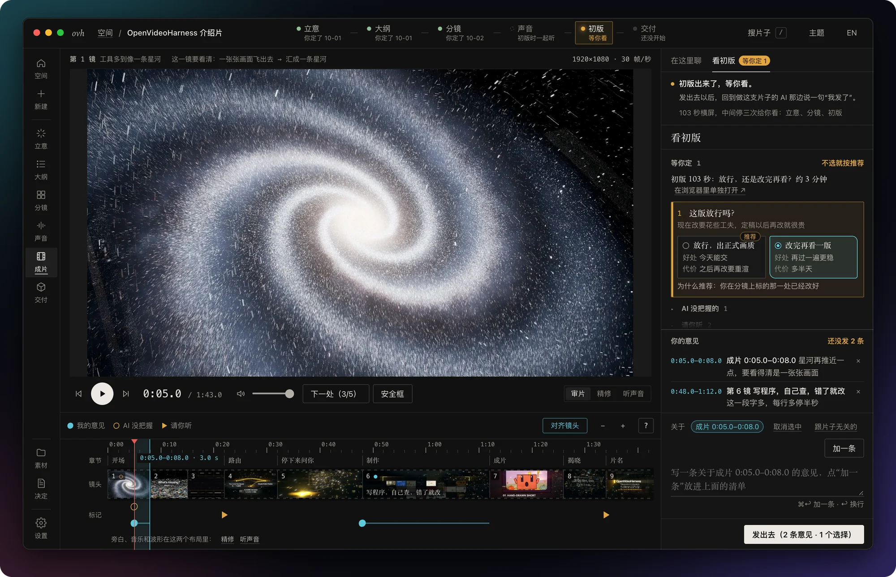
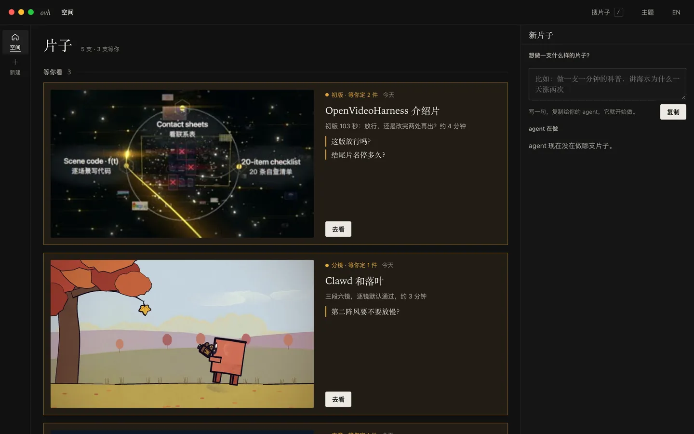
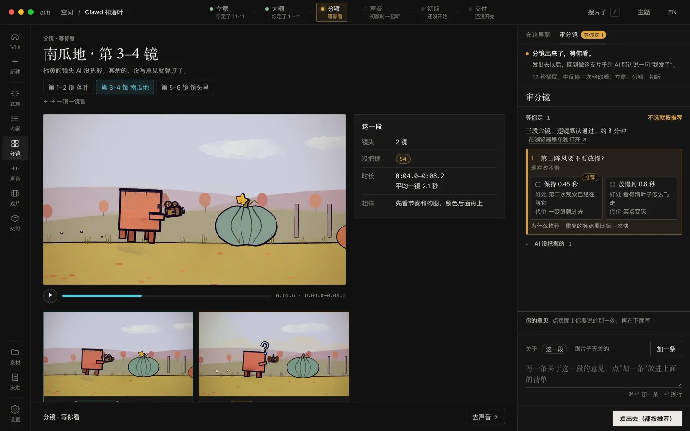
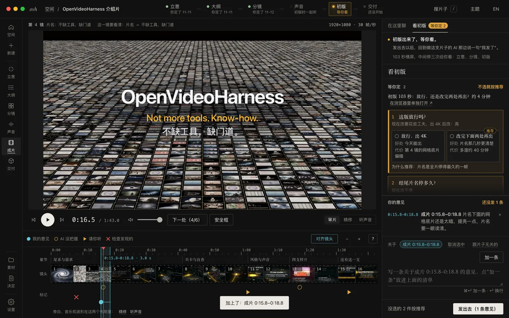
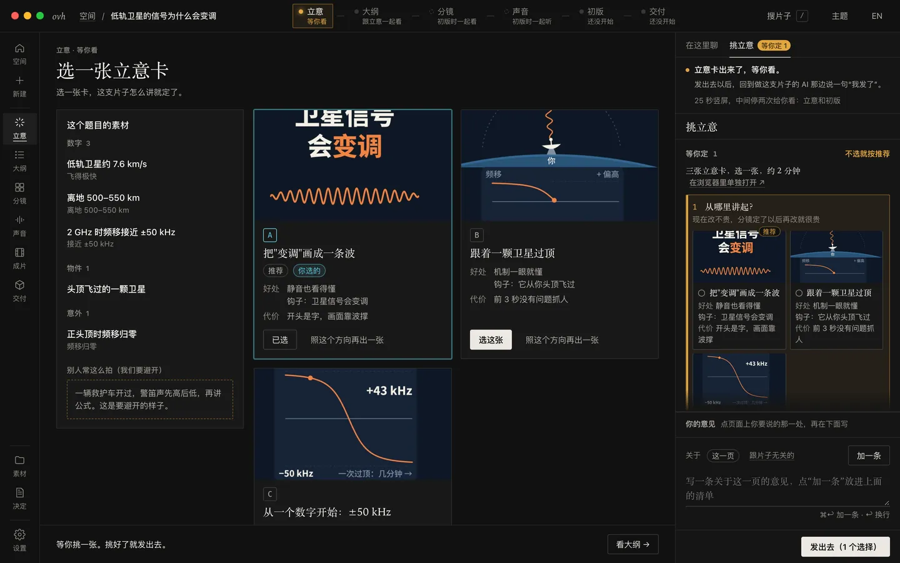
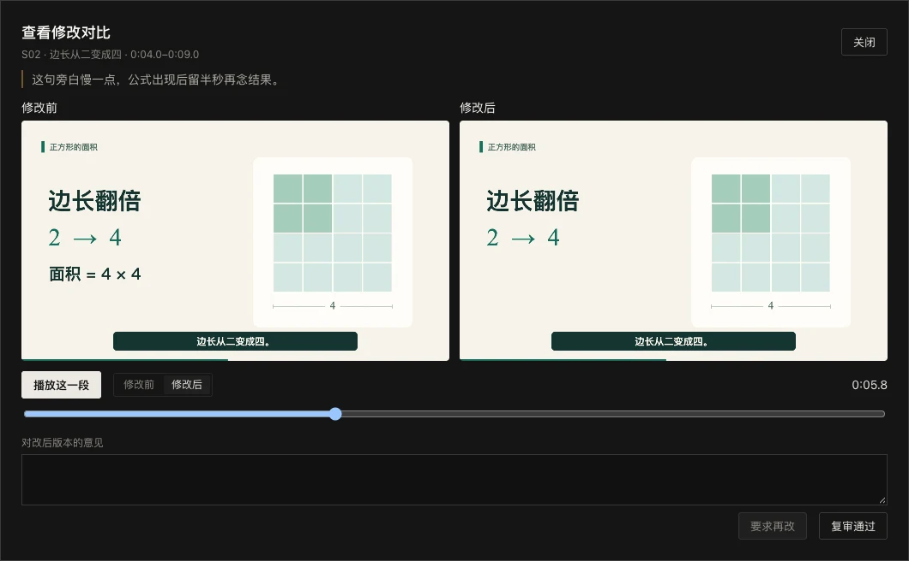
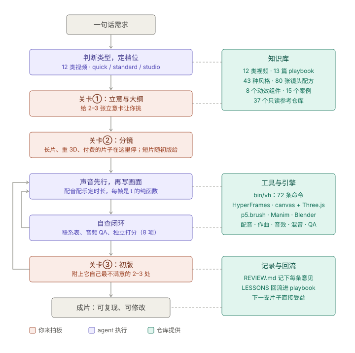
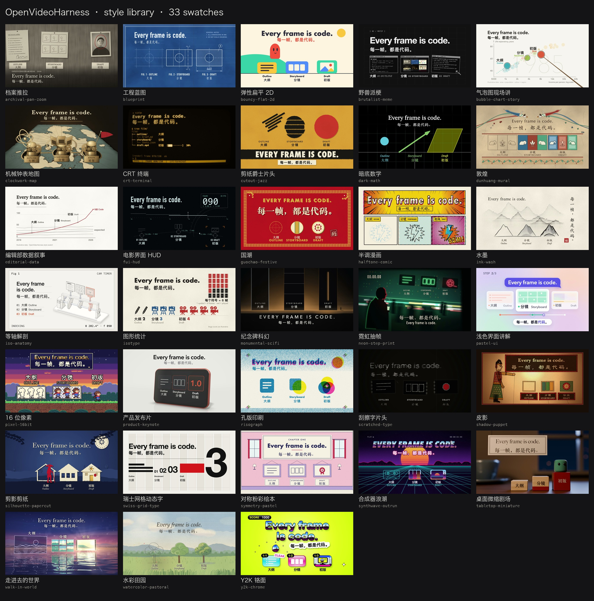
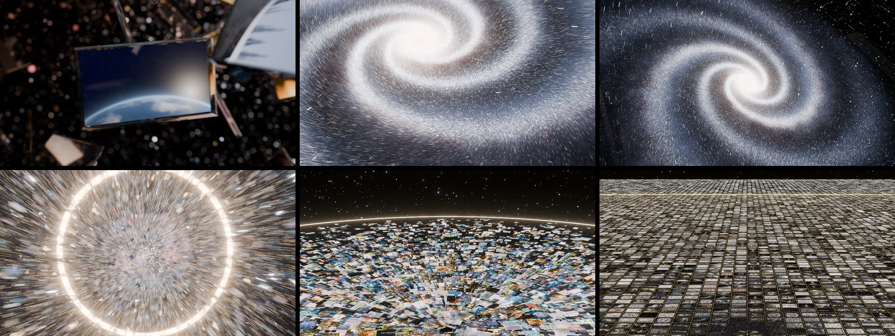

<div align="center">

# OpenVideoHarness

### 你当导演，AI 做片。

用代码做视频的一套可控工作流，开源。说一句想做什么，Claude Code、Codex 这样的 agent 写代码、渲染成片。每一步都摆在 Studio 里：指着画面说一句，它去改，改完两版对照着看。

一两句话让 AI 做出一支视频，现在很多工具都行。难的是可控、可重复、能成批地做，还能接进你自己的流程。这个项目做的就是这一套。

**[快速开始](#快速开始)** · [5 分钟介绍片](https://zlhad.top/OpenVideoHarness/docs/site/?lang=zh#tour) · [Studio 演示，17 秒带声音](https://zlhad.top/OpenVideoHarness/docs/site/?lang=zh#studio) · [看带声音的样片](#5-支样片点开有声音)

[English](README.md) · **中文** · [官网](https://zlhad.top/OpenVideoHarness/docs/site/?lang=zh) · [Wiki](https://github.com/ZLHad/OpenVideoHarness/wiki)


<a href="#能做出什么"></a>

<sub>都是用它做出来的片子。一个月十二支，加起来约 100 分钟，最长一支 33 分钟、4K。</sub>

**12 类视频 · 43 种风格 · 5 个引擎 · 配音、配乐、音效、字幕齐全 · 在你自己的电脑上跑 · MIT**

</div>

## 快速开始

<p align="center"><a href="https://zlhad.top/OpenVideoHarness/docs/site/?lang=zh#tour"></a></p>

<p align="center"><sub>动手前可以先看一遍。5 分 17 秒的介绍片，中文配音和字幕：怎么装，三种用法，一支 33 分钟的真片怎么一步步做出来，在 Studio 里怎么审。点图到官网带声音看，或下载 <a href="https://github.com/ZLHad/OpenVideoHarness/releases/download/media/tour-film-1080p-3750c1a5.mp4">1080p</a>（164 MB）/ <a href="https://github.com/ZLHad/OpenVideoHarness/releases/download/media/tour-film-4k-1cf1059a.mp4">4K</a>（740 MB）。这支片子也是用它做的。</sub></p>

需要 macOS 或 Linux、Git、Node.js ≥ 22、Chrome、FFmpeg、Python 3 和 [uv](https://github.com/astral-sh/uv)，以及已登录的 Claude Code 或 Codex。[完整要求](#要求成本和限制)

```bash
curl -fsSL https://raw.githubusercontent.com/ZLHad/OpenVideoHarness/main/install.sh | bash
```

装好后选一个入口开片。哪个顺手用哪个，从哪里开的片子都会出现在 Studio 里。

- **Studio**。从应用程序打开 **OVH Studio**，也可在安装目录运行 `bin/vh studio`。在右边选择 Claude Code 或 Codex。看到适配器安装提示时点「装上」，再发送需求。
- **终端**。在默认安装目录运行 `cd ~/OpenVideoHarness && codex` 或 `cd ~/OpenVideoHarness && claude`，再发送需求。
- **Claude Code 或 Codex 的桌面 App**。把安装目录（默认 `~/OpenVideoHarness`）当作项目打开，直接发送需求。
- **在别的文件夹里**。安装时已经给 Claude Code 和 Codex 各注册了一个叫 `open-video-harness` 的 skill。所以不管开着哪个项目，说一句"做一支视频……"，agent 都会找到工作台照着做。片子默认建在工作台的 `projects/` 下，想放在别处就说一声。只想装这个 skill，见[安装选项](#安装更新和国内网络)。

第一支可以试这条无声样片。

> 快速出一版 15 秒的竖屏无声科普，用方格和画面文字讲清楚为什么正方形边长翻倍，面积变成四倍。

源码和导出文件都留在这支片子的项目目录里。「快速出一版」会直接做到检查完的成片。要在立意和初版拍板，可以指定标准档或精品档。下一步代价较大时，分镜也会单独给你审。

[分步教程](https://github.com/ZLHad/OpenVideoHarness/wiki/%E5%BF%AB%E9%80%9F%E5%BC%80%E5%A7%8B) · [安装选项和更新](#安装更新和国内网络)

<p align="center"><a href="#studio"></a></p>

<p align="center"><sub>在 Studio 里做一支片子。顶上是片子走到了哪一步；指着时间线上的几秒或一个镜头写意见；右边是等你拍板的事，攒好一起发出去。画面里是本仓库自己的介绍片。</sub></p>

## 它哪里不一样

<table>
<tr>
<td width="44%" valign="top"><br><sub>时间是唯一的输入。这道闪光按微秒算。</sub></td>
<td valign="top"><b>片子是代码，所以可控、可重复。</b><br>每一帧只由时间决定，同一个时刻永远画出同一帧，所以能重做、能抽查。一支做好的 4K 片子，可以只重画其中几秒放回去，别的地方一帧不动。渲染断了，从断的地方接着来。每次渲染留一个版本，改前改后能对照着看。</td>
</tr>
<tr>
<td valign="top"><a href="https://zlhad.top/OpenVideoHarness/docs/site/?lang=zh#studio"></a><br><sub>17 秒看 Studio：看、指、说、定。点开是带声音的那一版。</sub></td>
<td valign="top"><b>整个流程，在一个窗口里。</b><br>在原来的 skill 和命令行之上，我们做了可视化的 Studio 窗口，让你更方便地掌握整个制作流程：每支片子走到哪一站、在等谁，一眼看到；审片时指着一秒写一句，攒几条一次发出去；要你拍板的事是几张卡，点一下就定。用起来就四个动作：<b>看</b>片子走到哪，<b>指</b>住某一秒或一个镜头，<b>说</b>一句想怎么改，在卡片上<b>定</b>下来。外观、语言、默认用哪个 agent、各家在线服务的 API Key，都在 Studio 的设置页里改，不用碰配置文件。</td>
</tr>
<tr>
<td valign="top"><br><sub>立意那一站上的原话："玻璃、宇宙、星穹……令人瘫坐眩晕的感觉"。</sub></td>
<td valign="top"><b>你来导演，它来干活。</b><br>它在立意和初版停下来等你；片子长、渲染重或要花钱，分镜也先给你看。还想亲自定钩子、配音、封面？点名就行。一个都不想管？说"直接出"。</td>
</tr>
<tr>
<td valign="top"><br><sub>一张股价图，同时也是一片山。</sub></td>
<td valign="top"><b>先想清楚说什么，再动手。</b><br>先出两三张立意卡，每张配一帧画面和一个钩子。它会先说出同题视频都长什么样，然后避开。</td>
</tr>
<tr>
<td valign="top"><br><sub>agent 在审自己渲出的帧。</sub></td>
<td valign="top"><b>交到你手上之前，它自己先查一遍。</b><br>agent 看不了视频，也听不了声音，所以凡是能量的都量。它对照 20 条的清单看联系表，用数据查声音，再把初版交给一个全新上下文的 reviewer，按 8 项打分。<code>bin/vh check</code> 能查出冻帧、闪烁、读不完的字幕和错误的色彩标记，每一项都告诉你怎么解决。</td>
</tr>
<tr>
<td valign="top"><br><sub>底图是生成的，上面叠代码，都记在台账里。</sub></td>
<td valign="top"><b>什么素材都能排进来。</b><br>代码画的画面、档案影像、生成的图、3D 模型、录来的声音，还有你自己的照片和录像（这两类还在试验），可以进同一支片子。一本台账记下每个文件的来源、许可和花费。没有预算，就不调付费接口。</td>
</tr>
<tr>
<td valign="top"><video src="https://github.com/user-attachments/assets/84cee687-619c-4d5a-ad49-e9b79412d419" controls width="100%"></video><br><sub>▶ 点开，打开声音：每个谐波有自己的音。</sub></td>
<td valign="top"><b>声音也在这套流程里。</b><br>配音、配乐、音效、字幕不用另找工具拼。旁白或音乐先定下来，量出每个字、每一拍的时间，画面就挂在这些时间上。配乐可以用代码写，也可以用你自己的曲子；音效落在动作发生的那一帧。</td>
</tr>
<tr>
<td valign="top"><br><sub>出自一支 33 分钟的片子。</sub></td>
<td valign="top"><b>长片也撑得住。</b><br>镜头、字幕、章节都挂在旁白的字上，加一段停顿，画面自己跟着走。剪辑表把页面和素材接起来，渲染能续，上传版按平台的上限出。目前最长的一支 33 分钟，4K。</td>
</tr>
</table>

**而且接得进你自己的流程。** 整套东西是写给 agent 读的文档，加一个命令行 `bin/vh`。一支片子就是一个文件夹，源码、分镜、审阅记录都是文本。换一个 agent、写进脚本、一个月做十几支，用的是同一套。

**也不是同一张 AI 脸。** 放任不管，AI 视频会趋向同一张脸：暗底、发光、玻璃卡片。这里是 43 种风格里的 32 种，下面每一格说的都是同一句话：

<a href="styles/"></a>

## Studio

在原来的 skill 和命令行之上，我们做了一个可视化的 Studio 窗口，让你更方便地掌握整支片子的制作流程。用起来就四件事：看片子走到了哪，指着画面说，在卡片上拍板，和 agent 说话。

<table>
<tr>
<td width="56%" valign="top"></td>
<td valign="top"><b>片子走到哪，一眼看到。</b><br>顶上一排是这支片子的几步：立意、大纲、文案、分镜、声音、初版、交付，片子有哪几步就排哪几步，每一步下面写着谁在做：你定了、等你看、Claude Code 在做、还没开始。左边一列是看什么：每一步的内容，另有素材和决定的记录。打开 Studio 先看到所有片子，等你的排在最前，卡上写着要你定什么。</td>
</tr>
<tr>
<td valign="top"></td>
<td valign="top"><b>审片，就是指着说。</b><br>分镜一段一页，每一镜一张关键帧；成片的时间线上排着镜头、声音、检查查出的问题和 AI 没把握的地方。选中一个镜头、一秒或一段，写一句，点“加一条”，就是一条意见。</td>
</tr>
<tr>
<td valign="top"></td>
<td valign="top"><b>攒几条，一次发出去。</b><br>意见都写给你指的那一处，攒在右边一列，每条写着还没发、发了还没人取，还是已经被取走。发出去之前先列一遍：每件事选了什么、每条意见说了什么。你的原话抄进项目的 <code>REVIEW.md</code>，agent 照着往下做。</td>
</tr>
<tr>
<td valign="top"></td>
<td valign="top"><b>要你定的事，就在这里定。</b><br>到了立意、分镜、初版，右边一列是这一步要你定的几件事，每件几张卡，推荐的已经选好。不动就是照推荐，点一下就换，最后发一次。</td>
</tr>
</table>

右边一列还能直接和这台机器上的 agent 说话（Claude Code、Codex，还有 DeepSeek Harness）。先选中一个镜头再开口，它就知道你指的是哪儿；它读了什么、跑了什么命令、要你批准什么，一条条摆在那里。在空间里，同一列就是开新片子的地方：写一句想做什么、发送，agent 一建好片子，这段对话就跟着进去。第一次和某个 agent 说话前要装一个适配器：在右边一列点「装上」，Studio 自己装好。

用哪个模型、想多深，都在“在这里聊”那一栏里选，Studio 记得你上次的选择。Codex 那一栏点 **选模型和思考深度**，它先开一个空对话，读出你的账号能用的模型，选好再发送需求。

点 **OVH Studio** 图标、对 agent 说"打开 Studio"，或者运行 `bin/vh studio`，都会打开同一个窗口。精品档默认在 Studio 审阅。Studio 显示 agent 正在等反馈时，点"发出去"就能叫醒它；其余情况发出去以后回原对话说一声"我发了"。标准档在 Studio 开着时也在 Studio 审，没开时发静态审阅页；也可以指定用哪个。界面有中文和英文，三套深色主题：暗场、棱镜、舰桥。[打开 Studio](#打开-studio) · [Studio 文件约定](tools/desk/README.md)

<table>
<tr>
<td width="56%" valign="top"></td>
<td valign="top"><b>同一段改完了，接着复审。</b><br>agent 把两版成片关联到你的意见后，从<b>成片 → 复审</b>打开。两版同步播放，可切换试听音轨。可以通过，也可以针对改后版本再提意见。终端用 <code>bin/vh desk revision</code> 提交这组对照。</td>
</tr>
</table>

### 打开 Studio

点 **OVH Studio** 图标、对 agent 说"打开 Studio"，或者在终端里运行 `bin/vh studio`（`bin/vh studio <项目>` 直接打开到那支片子），出来的都是同一个窗口，再叫一次只是把它带回最前面。关掉窗口，Studio 还在后台开着，正在干活的 agent 接着干；再点图标，窗口回到原来的地方；退出 OVH Studio，Studio 才停。放在别的文件夹里的片子，用 `bin/vh studio <项目>` 打开，也加进这一个窗口。

图标没装上时，`bin/vh studio --install-icon` 补装。没有 OVH Studio 时，窗口用电脑上的 Chrome、Edge、Chromium 或 Brave；这几样都没有，就开在默认浏览器的一个标签页里。

## 能做出什么

下面是作者用它在大约一个月里做的十二支片子的片段，这十二支加起来约 100 分钟。物理、化学、工程、金融、民俗、文学、思考，每支都有自己的世界。片子都是中文的，这里是无声的。

<table>
<tr>
<td width="33%" valign="top"><br><sub>黑洞喷流，全部用 Canvas 2D 画<br>7 分半物理科普</sub></td>
<td width="33%" valign="top"><br><sub>互为镜像的分子，Three.js<br>2 分钟化学科普</sub></td>
<td width="33%" valign="top"><br><sub>流体把自己卷起来<br>3 分钟数学故事</sub></td>
</tr>
<tr>
<td valign="top"><br><sub>剖开制动主缸，镜头跟着油路走<br>14 分钟拆解，Three.js</sub></td>
<td valign="top"><br><sub>刹车盘发热，伪彩热成像</sub></td>
<td valign="top"><br><sub>鼓式刹车受热胀大</sub></td>
</tr>
<tr>
<td valign="top"><br><sub>2008 年是一座灰色的城<br>9 分半数据片，60 帧</sub></td>
<td valign="top"><br><sub>2015 年是霓虹</sub></td>
<td valign="top"><br><sub>把一个猜想做成地形</sub></td>
</tr>
<tr>
<td valign="top"><br><sub>皮影，用代码画的<br>3 分钟民俗史</sub></td>
<td valign="top"><br><sub>水墨，菊花慢慢开</sub></td>
<td valign="top"><br><sub>青绿山水，一首唐诗</sub></td>
</tr>
<tr>
<td valign="top"><br><sub>同一支片子，走到今天的楼道</sub></td>
<td valign="top"><br><sub>一支笔当场画出机器<br>3 分钟科技史</sub></td>
<td valign="top"><br><sub>剪影长出翅膀<br>9 分钟作家小传</sub></td>
</tr>
<tr>
<td valign="top"><br><sub>一本打开是盒子的书</sub></td>
<td valign="top"><br><sub>灯、大脑、书房<br>33 分钟思考片</sub></td>
<td valign="top"><br><sub>一束光走过整棵树</sub></td>
</tr>
<tr>
<td valign="top"><br><sub>把软件拆成一层层玻璃<br>4 分钟技术故事，Three.js</sub></td>
<td valign="top"><br><sub>发现沿着轨道一个个亮起来</sub></td>
<td valign="top"><br><sub>从手机到卫星，清爽的平面插画<br>2 分半科普</sub></td>
</tr>
</table>

### 5 支样片，点开有声音

播放器默认静音，点开后记得打开声音。每支片子在 [`showcase/`](showcase/) 里有一个目录，放着需求、Brief、分镜、审阅记录和全部源码，可以直接拿来当同类片子的起点。每一支都是 agent 只照着本仓库的文档做出来的。

<table>
<tr>
<td width="42%" valign="top"><video src="https://github.com/user-attachments/assets/48923404-eff1-41cd-b303-82c9ede51c1f" controls width="100%"></video></td>
<td valign="top"><b><a href="showcase/04-intro-film/README.zh-CN.md">04 · 介绍片</a></b><br><sub>Blender + HyperFrames + Three.js · 103 秒 · 精品档</sub><br>118 万颗星组成的星系用 Blender 路径追踪渲出来，坍缩、压平成一片影片之海；之后一个连续的 3D 长镜头，跟着一句需求走完整个仓库。这里是开场，全片链接在下面。<br><b><a href="showcase/04-intro-film/README.zh-CN.md#你说了什么原话">需求</a>（关卡 ① 上的原话）：</b>"玻璃、宇宙、星穹……令人瘫坐眩晕的感觉"<br><sub><a href="https://github.com/ZLHad/OpenVideoHarness/releases/download/media/intro-film-1080p.mp4">1080p 原片（297 MB）</a> · <a href="https://github.com/ZLHad/OpenVideoHarness/releases/download/media/intro-film-4k.mp4">4K（1.04 GB）</a></sub></td>
</tr>
<tr>
<td valign="top"><video src="https://github.com/user-attachments/assets/efa32859-7bdc-4507-be20-504c429ec5f5" controls width="100%"></video></td>
<td valign="top"><b><a href="showcase/02-short-leo-doppler/">02 · 竖屏科普</a></b><br><sub>HyperFrames · 24.8 秒 · 1080×1920</sub><br>低轨卫星的信号为什么会"变调"，关掉声音也看得懂。中文配音，中英字幕。<br><b><a href="showcase/02-short-leo-doppler/README.md#the-request-this-was-built-from">需求</a>：</b>"为什么低轨卫星的信号会'变调'？——多普勒频移"</td>
</tr>
<tr>
<td valign="top"><video src="https://github.com/user-attachments/assets/84cee687-619c-4d5a-ad49-e9b79412d419" controls width="100%"></video></td>
<td valign="top"><b><a href="showcase/03-math-fourier/">03 · 3Blue1Brown 式数学讲解</a></b><br><sub>Manim · 25 秒 · 1920×1080</sub><br>正弦波一层层叠成方波，最后停在吉布斯过冲上。英文旁白，每个谐波有自己的音。<br><b><a href="showcase/03-math-fourier/README.md#the-request-this-was-built-from">需求</a>：</b>"Building a square wave from sine waves"（用正弦波拼出方波）</td>
</tr>
<tr>
<td valign="top"><video src="https://github.com/user-attachments/assets/b34576a9-f0f3-48b5-96b1-aba539b38d37" controls width="100%"></video></td>
<td valign="top"><b><a href="showcase/01-handdrawn-clawd-leaf/">01 · 手绘角色短片</a></b><br><sub>p5.brush · 12 秒 · 1920×1080</sub><br>没有字、没有旁白的三镜头默剧，配乐和拟音跟着每个动作走。<br><b><a href="showcase/01-handdrawn-clawd-leaf/README.md#the-request-this-was-built-from">需求</a>：</b>"Clawd tries to film a falling autumn leaf with a tiny hand-cranked movie camera; the wind keeps snatching the leaf just as Clawd frames it …"（Clawd 用手摇小摄影机拍一片落叶，风总在它对准的时候把叶子抢走……）</td>
</tr>
<tr>
<td valign="top"><video src="https://github.com/user-attachments/assets/4f662b1a-ba4d-4485-9a84-ac821f6be7b1" controls width="100%"></video></td>
<td valign="top"><b><a href="showcase/00-promo-launch-film/">00 · 发布短片</a></b><br><sub>HyperFrames · 20 秒 · 1920×1080</sub><br>用这个仓库自己的终端、路由表和联系表搭成，画面上每个动作都有音效。<br><b><a href="showcase/00-promo-launch-film/README.md#the-request">需求</a>：</b>"Produce the README hero video — a short launch film for OpenVideoHarness itself …"（做 README 首屏的主视频：一支给 OpenVideoHarness 本身的发布短片……）</td>
</tr>
<tr>
<td valign="top"><video src="https://github.com/user-attachments/assets/3ecb0f0c-5602-496b-aebc-4848a918a74c" controls width="100%"></video></td>
<td valign="top"><b><a href="styles/">风格连播</a></b><br><sub>43 种风格里的 32 种 · 每种约 1.5 秒</sub><br>同一段内容，用风格库里的每一种风格各渲一遍，每种配自己的音乐。</td>
</tr>
</table>

片子都放在 [Release `media`](https://github.com/ZLHad/OpenVideoHarness/releases/tag/media) 里，不进 git，克隆仓库不用下载它们。00–03 这四支先做成无声片，声音是后来配上的。社区里的同类作品和我们的拆解在 [`cases/`](cases/README.md)；你用本仓库做出的片子，也欢迎 PR 进 `showcase/`。

## 为什么做这个

做视频的工具现在很多。给一个 agent 或一个模型一两句话，它就能做出一支视频。

可做出一支，和把这件事做成日常，是两回事。想改其中几秒，往往只能整支重做。同一句话再来一次，节奏和画风可能全变。做到第十支，说不清是哪一步出了问题。要它可控、可重复、能成批地做，还要接进你自己的流程，靠一两句话不够，得有一套可控的工作流。

所以我们做了这个项目。片子是代码，哪一帧都能单独重画。流程是写下来的，立意、分镜、声音、检查各有各的做法。该停下来给人看的地方由你定。这些都写成 agent 能照着做的样子：几条底线不让步，其余都是默认，好点子可以反着来。

它是从真片子里长出来的。哪支片子出了问题，教训就变成一篇文档或一项检查，下一支片子从这里接着做。

## 它怎么工作

一支片子在这里是一份源码。agent 写一个页面（或一段 Manim 场景、一个 Blender 脚本），里面每一帧都是时间 t 的函数；真实影像、生成的图、3D 模型和声音按一张剪辑表排进来；浏览器（或 Manim、Blender）逐帧画出来，FFmpeg 再接上音轨。

<p align="center"></p>

一共四层，agent 只读手上这支片子用得到的部分：

| 哪一层 | 里面有什么 |
|---|---|
| **路由** | [CLAUDE.md](CLAUDE.md)：这是 12 类视频里的哪一类、做多认真、谁拍板什么，以及不让步的底线 |
| **门道** | agent 照着做的文档：[视频类型](video-types/)、[playbook](playbook/)、[风格](styles/README.md)、[配方](recipes/README.md)、[组件](components/README.md)、[案例](cases/README.md) |
| **工具** | 一个命令行 `bin/vh`：从选题调研到上传版（见[工具一览](#工具一览)） |
| **引擎** | HyperFrames、canvas + Three.js、p5.brush、Manim、Blender，它告诉 agent 怎么用（见[引擎](#引擎)） |

一支片子这样走：

1. **判断类型**：路由表定下是哪一类、照哪份工作流做；做多认真、哪些事你要亲自定，按你的需求来。
2. **关卡 ①：立意和大纲**：两三张立意卡，每张配一帧画面和一个钩子。选定一张，立意、画面风格和钩子就一起定了，这时还没写一行代码。
3. **分镜**：每个镜头写清观众要依次看懂什么、各占几秒，每镜一张关键帧。片子长于约 90 秒、3D 渲染重或要调付费接口时，它在这里停下来等你（关卡 ②）；短片的分镜随初版一起给你看。
4. **声音先行**：先做旁白或配乐，量出每个字、每一拍的时间，画面挂在这些时间上。
5. **写代码，自己查**：每写完一段，把帧拼成联系表，对着清单改，再用数据查声音；整片初版交给一个全新上下文的 reviewer 打分。
6. **关卡 ③：初版**：给你看初版、联系表、评审分数和它最不满意的地方。你说不清哪里不对时，它把同一段做成两三个版本让你挑。
7. **出片**：成片过一遍 `bin/vh check`，这次踩的坑写进项目的 `LESSONS.md`。

几条从不放松的规则：每一帧只由 t 决定；有声音时声音定时长；先分镜后代码；数字、引文、论文信息照抄原文，拿不准的不编进片子；API key 只放在环境变量或 Studio 设置页（系统钥匙串）里，绝不写进文件。

**量到什么就公开什么，对自己不利的也一样。** 我们做过两次小规模盲评：[docs/research/06](docs/research/06-concept-first-ab.md) 里，按流程做的片子点子更新，但评审觉得只守底线的两支做工更好、两次选它们去发；[docs/research/10](docs/research/10-page-vs-workflow.md) 拿不用引擎（`--engine page`）对默认流程盲评，平均 6.92 对 7.09 不分高下。评审指出的问题后来都变成了检查，其余记录在[研究笔记](docs/research/README.md)里。

### 需求示例

说清楚讲什么、给谁看、发在哪就够了，不用写长篇 brief：

| 想做 | 这样说 |
|---|---|
| 数学讲解 | "3Blue1Brown 那种风格，讲傅里叶级数怎么一点点拼出方波，20 秒，静音也能看懂。" |
| 产品片 | "给我的 App 做一支 30 秒发布片，用水墨风格，只用真实截图，关键动作配音效。" |
| 产品教程 | "给我的命令行工具做一支 2 分钟使用教程：从安装到跑通第一个例子，终端打字和界面操作全部用代码重做，不录屏。" |
| 论文讲解 | "把 `papers/main.tex` 的核心方法做成 3 分钟讲解，论文信息照抄原文，英文旁白加中文字幕。" |
| 资料片 | "用 NASA 公有领域的发射影像剪一支 40 秒的倒计时短片，每段素材的许可都记下来。" |
| 快速试一版 | "快速出一版 15 秒的草稿，看看赛博故障风适不适合我的游戏预告，不用问我。" |
| 深度参与 | "做一支 90 秒的知识视频，讲卫星怎么避免相撞，要精品。开头钩子、主角、主旋律、标题和封面我来定，其余你定。" |

## 工具一览

工具跟着做片子的顺序走：想、找料、做、查和交付。下表每个名字都是一条 `bin/vh` 命令；`bin/vh commands` 按流程阶段列出全部 74 条命令，每条命令加 `-h` 看用法。

| | 命令 | 做什么 |
|---|---|---|
| **想** | `know` | 仓库里关于几个词已经有什么（配方、组件、风格、playbook 的某一节、案例），不用先读文档 |
| | `scout` | 选题前看一个题目在各平台上的样子（头部视频和其中的异类、热榜），片子发出去以后看它的数据；只用公开接口，不登录 |
| | `ref` | 把参考的视频、帖子、图片、网页记下来：从哪来、什么许可、为什么参考它；长视频读成带时间码的文稿，再按文稿挑段看帧 |
| | `web` | 保存网页及网址、日期、HTTP 状态以核对事实；默认复用已装的 Chrome/Chromium，Obscura 可选 |
| | `breakdown` | 拆一支参考片：切点和转场落在节拍的哪里、关键帧、可以换掉什么 |
| | `concept` | 立意卡的可选配件：按项目名抽取框架的"轮盘"，以及"六选三"页 |
| **找料** | `footage` | 从 Internet Archive、Wikimedia Commons 和 NASA 取真实影像，只取要用的几秒，每段的许可都记进台账 |
| | `image` | 用 Gemini 的 Nano Banana 或 Codex 的 image_gen 生成图：先估价，每次付费调用先按项目预算占住；也能抠出透明图 |
| | `sfx` · `bgm` · `sound` | 从你自己的声音库和 Openverse 里找录好的音效、有许可的配乐，连同署名一起取进项目 |
| | `cast` | 项目里的角色、服装、道具和场景，定稿的参考图各放一个目录，`image gen --ref cast:<id>` 会带上它们 |
| | `model3d` · `hdri` | 3D 模型放进来之前先读一遍；从 Poly Haven 取 CC0 的环境贴图给它打光 |
| | `assets` | 片子用到的每个文件记在一本台账里：从哪来、什么许可、花了多少钱；交付前 `check`、出 `credits` |
| **做** | `new` | 按模板建项目，大多数类型会一起搭好引擎；加 `--engine page` 可以不用引擎、自己写页面 |
| | `style` · `recipes` · `components` | 风格预设、镜头配方和镜头语法卡、动效组件 |
| | `edit` | 把片子写成剪辑表：页面、图片、实拍素材、别的片子和声音排成一列 |
| | `words` | 查旁白稿和字幕稿里模型顺手的句式（"不是 A 而是 B"、三连排比、下结论的冒号这些）：在哪、多密，由你决定改不改；它不改稿 |
| | `tts` · `music` · `captions` · `mix` | 配音、用代码写的配乐、字幕、混音（见[声音](#声音)） |
| **查和交付** | `studio` · `gate` · `desk` | 叫出 [Studio](#studio) 的窗口；一条命令停下来等你拍板；`desk` 是 Studio 背后的控制台，也能只开一支片子的审阅台 |
| | `frames` · `sheet` · `determinism` | 无损取帧、联系表，以及查每一帧是不是真的只由 t 决定 |
| | `check` | 对着 Brief 查成片：黑场、定格、静音、闪烁、字幕、色彩标记、响度 |
| | `render` | 分块并行渲 MP4，中断了能续渲，每次渲染都留一个版本 |
| | `patch` · `versions` | 只重画成片里的几秒；对比各版渲染，或者退回某一版 |
| | `deliver` · `clean` | 出上传用的版本；清掉做完的项目里的中间文件 |
| | `artifacts` | 项目里每种文件是什么、谁写的；这支片子有什么、缺什么、什么过期了 |
| | `projects` · `cancel` · `history` | 所有项目和各自到哪了；停下一条正在跑的命令，并在记录里写清楚；你和 agent 写的文本的退路 |

`bin/vh doctor` 读 `tools/modules.json`，告诉你这台机器能用上 44 个外接模块（程序、包、模型和联网服务）里的哪些。

## 引擎、类型和素材库

### 引擎

它不是渲染引擎，而是架在这些引擎之上，告诉 agent 怎么用好它们：

| 引擎 | 画什么 | 用在哪 |
|---|---|---|
| [HyperFrames](engines/README.md#hyperframeshtml--gsap)（HTML + GSAP） | 有真实字体和排版的页面；还有一个现成积木的注册表（`bin/vh hf`） | 科普短视频、产品片、数据故事、梗图快剪、风格样片 |
| [canvas-film](engines/canvas-film/README.md)（canvas 2D），可选 Three.js 层 | 旁白撑着的长片：镜头、字幕、章节进度条都挂在旁白的字上；GLB 模型和它的动作画在 2D 下面 | 任何类型（`--engine canvas-film`；加 `--three` 带上 3D 层） |
| [ClaudeAnimationBase](engines/ClaudeAnimationBase/)（p5.js + p5.brush），自带 | 手绘线条、水彩、角色 | 手绘短片、MV |
| Manim CE，可选更快的后端 [ManimGX](engines/manimgx.md) | 数学和机制 | 数学、科学讲解，论文讲解 |
| [Blender](engines/blender.md) 5.2，可选 | 路径追踪的光影、物理、真实景深；或者把 3D 资产整理好交给 Three.js 层 | 网页引擎做不到的镜头 |

想自由发挥、做创意或实验短片，也可以**不用现成引擎**：`bin/vh new <type> <slug> --engine page` 只放一个守页面合约（[`engines/CONTRACT.md`](engines/CONTRACT.md)）的空白 `film.html`，不装依赖，画什么、用什么库由你定，取帧、出片、检查和 Studio 审阅工具照样用（见 [`engines/page/README.md`](engines/page/README.md)）。Remotion 在几份类型文档里列为备选，没有样片用它，要手动初始化（见 [engines/README.md](engines/README.md)）。

### 视频类型

| 类型 | 适合做什么 | 首选引擎 | 文档 |
|---|---|---|---|
| 01 数学、科学讲解 | 3Blue1Brown 式的原理动画 | Manim | [01](video-types/01-math-science-explainer.md) |
| 02 知识科普短视频 | 抖音、B 站、小红书、视频号、Shorts | HyperFrames | [02](video-types/02-knowledge-short.md) |
| 03 产品片、发布片 | App、SaaS、开源项目的介绍和功能演示 | HyperFrames | [03](video-types/03-product-promo.md) |
| 04 歌词视频、MV | 跟着音乐走的动画 | p5.brush 或 HyperFrames | [04](video-types/04-lyric-music-video.md) |
| 05 数据故事 | 动态图表、数字可视化 | HyperFrames + SVG | [05](video-types/05-data-story.md) |
| 06 论文讲解 | 会议视频、学术报告 | Manim 或 HyperFrames | [06](video-types/06-paper-explainer.md) |
| 07 手绘短片 | 水彩、白板、剪纸、角色小短片，能按笔顺写汉字 | p5.brush（自带） | [07](video-types/07-hand-drawn.md) |
| 08 梗图快剪 | 野兽派、科技推特风 | HyperFrames | [08](video-types/08-brutalist-meme.md) |
| 09 剪你自己的素材（试验中） | 口播、访谈：删口水词、加字幕和图解、出竖屏版 | HyperFrames | [09](video-types/09-editing-talking-head.md) |
| 10 长讲解 | 10 分钟以上的横屏讲解 | canvas-film | [10](video-types/10-long-explainer.md) |
| 11 照片回顾（试验中） | 你自己的照片和片段：婚礼、旅行、一年回顾 | canvas-film + 剪辑表 | [11](video-types/11-photo-recap.md) |
| 12 产品使用教程 | 软件怎么装、怎么用，操作用代码重做，不录屏 | canvas-film + `ui-stage` | [12](video-types/12-product-tutorial.md) |

要写实人物或真实物理时，接生成式视频再用代码叠加（[playbook/05](playbook/05-hybrid-genvideo.md)）；讲有起伏的故事或 3 分钟以上的长片看 [playbook/09](playbook/09-narrative.md)；开头钩子、标题和封面看 [playbook/10](playbook/10-hooks-and-packaging.md)。

### 风格

AI 做的视频放着不管，很容易长成一个样子：暗底、发光、玻璃卡片。[`styles/`](styles/README.md) 收了 43 种风格，多数从名作里提炼：Saul Bass 的片头、瑞士网格、3Blue1Brown、《纽约时报》的数据图、《蜘蛛侠：平行宇宙》的网点、韦斯·安德森的对称构图、水墨、敦煌、皮影、国潮等。每种都写清颜色、字体、构图、运动、转场和声音，并实际渲染了一段样片（前 33 种是同一段内容的 5 秒样片）：

<a href="styles/"></a>

风格是参考，不是模板：可以借一种、借几种，也可以完全不借。学的是视觉语法，不用原作的角色、logo 和镜头。`bin/vh style list` 看全部，`bin/vh new promo launch-film --style cutout-jazz` 给项目挂一种当参考。

### 配方、镜头语法卡、组件

- **[配方](recipes/README.md)**：80 张镜头配方（一个镜头或一个接缝怎么动：分几段、每段多少帧、哪些参数不能降、在哪容易翻车），另有 11 条全片骨架（整支片子的能量弧和停顿预算）。`bin/vh recipes list --intent … --energy …` 按意图和能量筛；写了代码草图的配方都带一张实渲的样片联系表。
- **镜头语法卡**：`recipes/shot/` 里有 24 张镜头语法卡，讲景别、角度、轴线和运镜，每张写它对观众起什么作用、什么时候用、什么时候别用。选定的写进镜头表的 `camera`，`bin/vh storyboard` 会印在镜头下面。
- **[组件](components/README.md)**：8 个动效组件（弹簧场景、翻页、纸面转场、章节进度条、一块块搭起来的建筑、给太干净的画面收尾、教程里的操作台：打字、键盘、光标和真截图，还有标明出处的铭牌），每个都由 t 算出状态，再用很薄的一层画进 canvas、DOM 或 Three.js。`bin/vh components add` 把它复制进项目。

这些都是起步用的默认做法，不是规则：立意需要别的做法，直接做就行。

## 声音

AI 听不见，所以声音尽量做成能计算、能测量的。

- **配音**（`bin/vh tts`）：默认是本地开源的 Qwen3-TTS，在 Apple Silicon 上离线免费，中文 5 个音色、英文 2 个。云端可以接 Gemini、MiniMax、ElevenLabs、阿里云百炼，还有 Edge 的在线音色，打草稿可以用 macOS 自带的 `say`。加 `--align` 能拿到逐字时间，字幕和画面可以挂在某个字上。
- **字幕**（`bin/vh captions`）：旁白稿写成 `中文 || English`，出中文、英文或双行字幕，烧进画面或做成可开关的字幕轨。
- **配乐**（`bin/vh music`）：用代码作曲，同一份谱永远生成同一段音乐，并给出每一拍的时间让画面卡点；有类编钟、古筝、笛子这些中国乐器。用你自己的曲子时，`bin/vh beats` 分析节拍；`bin/vh bgm` 在 Openverse 找一首 CC 许可的曲子，在强拍上截好；`bin/vh music --provider lyria` 用 Google 的 Lyria 生成一首（按首付费，先按预算占住，记进台账、标成 AI 生成）。
- **音效**（`bin/vh sfx`）：21 个用代码合成的音效，摆在动作发生的那一帧；每支片子按自己的顺序取变体，重复的音效听着不一样。也能用录好的，来自你自己的声音库和 Openverse 上 CC0、CC BY 的音效，许可和署名都记下来。
- **混音和质检**（`bin/vh mix`、`bin/vh qa`）：有旁白时音乐自动让开，整体响度按 −14 LUFS；`qa` 查断音、掉音、忽大忽小、爆音，以及偏了不止一帧的卡点。机器判断不了的，`qa --listen 5` 剪出几段让人戴耳机听。

详见 [playbook/04-audio.md](playbook/04-audio.md)。

## 3D

有些镜头网页给不了：真玻璃的折射、体积光、真实的景深、上百万个粒子。这时 agent 写 Python 驱动 Blender。介绍片的开场就是这样做的：numpy 算出 118 万颗星每一帧的位置，Cycles 路径追踪渲染，475 帧在 M3 Max 上按 1080p 渲了 1 小时 28 分。

<p align="center"></p>

- **旁白片里放 3D**：用 canvas-film 的 Three.js 层（`--three`），GLB 模型画在 2D 下面，动作按旁白的字放，每一帧都是 t 的函数。
- **模型放进来之前**：`bin/vh model3d check` 先读一遍，面数、贴图、骨骼、动作名和时长、以米计的尺寸；加 `--blender` 再在 Blender 里查面片打架、零件翻面。
- **打光**：`bin/vh hdri` 从 Poly Haven 取 CC0 的环境贴图，给场景打光、当背景。
- **Blender 只做资产**：不需要路径追踪的镜头，Blender 只负责整理、绑骨、导出模型，由 Three.js 层出片。
- **安全**：Blender 脚本运行时拿不到你的环境变量，也就拿不到 API key；在 macOS 上还套着不联网的沙箱。什么时候值得用、怎么接进片子，见 [engines/blender.md](engines/blender.md)（部分验证）。

## 剪辑表

一支片子不必是一个页面。`edit.json` 把它排成一列条目，每条按自己的方式画：一个页面（愿意的话一章一个引擎）、一张带推拉的图、一块颜色、还没做的灰卡、一段实拍素材、另一个项目的成片，再加几条声音轨。`bin/vh edit init` 把镜头表变成剪辑表，每个镜头先是一张按计划计时的灰卡，这就是关卡 ② 的全长 animatic；之后再把灰卡一张张换成真的。

`bin/vh render` 先解析剪辑表，在每个切点放关键帧，把渲好的每一块存起来，改动之后再渲，只画变了的条目。`bin/vh patch`、`check`、`deliver` 读的是同一份表，还留着灰卡的片子交付不了。任何页面，不管在不在剪辑表里，渲染时都能加 `--motion-blur N`（每帧由 N 个子帧平均而成，切点照样是硬切）或 `--alpha`（出透明底的片子，叠在实拍上）。格式见 [engines/EDIT.md](engines/EDIT.md)。

## 做多认真、谁来拍板

档位管的是 agent 自己查多细、评审几轮，不管成片好坏：三档出的都是正式画质的成片。中途停几次看片子，不看档位：下一步贵（长渲染、花钱）的地方才停，第一次停时它会说这支片子打算停哪几处。想自己定，三种说法就够：**直接出**（中间不看）、**看方向和初版**、**每步都看**。在需求里说"快速出一版""直接出，我不看"或"做成精品"，或者建项目时写 `--effort`。

| | 快出 `quick` | 标准 `standard`（默认） | 精品 `studio` |
|---|---|---|---|
| 适合 | 一句话直接出片 | 想在关卡上亲自拍板的正式视频 | 要多轮打磨的发布片、旗舰内容 |
| 停下来等你 | 不停 | 立意和初版；长片、重 3D、付费的片子再加分镜 | 同标准，每张立意卡附一段 10–20 秒的草图，停分镜时附全长 animatic |
| 全新上下文的评审 | 不做 | 1 轮，修最重要的至多 3 处 | 3 到 10 轮，做工五项都要 7 分以上 |
| 30 秒的片子大概要 | 10–30 分钟 | 1–2 小时 | 3 小时以上 |

哪一档都不放松的：事实不编、有声片里没有突然的静音、画面不频闪、字不小于目标屏幕的下限、素材许可记清楚、没有预算不调付费接口。

想管得更细，可以点名哪些事自己定：开头钩子、风格、主角、主旋律、配音、旁白稿、分镜、标题和封面。点了名的，它出几个选项等你挑；没点名的，它自己定，理由写进项目的 `DECISIONS.md`，你随时能改。每次停下来是一条命令（`bin/vh gate`）。`standard` 档默认生成一个本地审阅页：画面在前，要你定的事是能点的卡片，没把握的地方标在播放器下面的标尺上，点一下跳到那一秒；Studio 开着时，`standard` 档的这一站改开在 Studio 里。`studio` 档默认停在 [Studio](#studio) 里，打开在等你的那一站，你一提交 agent 就接着做。两种页面都有中英文，跟着你第一句话的语言走。

## 要求、成本和限制

| 需要 | 用来做什么 |
|---|---|
| macOS 或 Linux、git | 基础（Windows 没有测过） |
| Node.js ≥ 22、Google Chrome | 在浏览器里画帧 |
| FFmpeg | 编码、混音、检查 |
| Python 3 + [uv](https://github.com/astral-sh/uv) | 声音工具、联系表、Manim；依赖第一次用时装进 uv 的缓存 |
| Apple Silicon | 本地 Qwen3-TTS 配音和本地逐字对时（换云端配音就不需要） |
| LaTeX | Manim 里的公式 |
| Blender 5.2 | 只有路径追踪的镜头和整理 3D 模型才要；沙箱目前只在 macOS 上有 |

- **成本**：渲染、配乐、音效都在本地跑，不花钱。要花的是 agent 本身（Claude Code 或 Codex 的订阅或 API 用量），以及你选用的云端配音、生成图、生成音乐、生成式视频，按各家收费。付费调用要有预算（Brief 的 `Budget:`，或者 `LOCAL.md` 里的默认预算），调用前先按预算占住。API Key 从环境变量读，或者用 Studio 设置页里存的（见 [API Key](#api-key)）。
- **时间**：30 秒的标准档片子大约 1–2 小时，大部分花在自查和返工上。
- **限制**：agent 看不了视频、听不了声音，只能看渲染出的帧、读声音的数据，所以最后一关还是要你看、你听；目前只在 macOS（Apple Silicon）上完整跑过，Linux 上在 Ubuntu 24.04（arm64，Docker 里）做过一支无声片，在一台云端容器（Ubuntu 24.04，x86_64）里做过七支有声片（[研究笔记 10](docs/research/10-page-vs-workflow.md)），事先要备好的三样见 [engines/README.md](engines/README.md#linux渲染前要先备好的三样)；写实人物要靠生成式视频；第 09 类剪辑还在试验，没有用真实素材试过。

### API Key

配音默认用这台电脑上的声音，不用 API Key。在线服务（Gemini、MiniMax、ElevenLabs、阿里云百炼）要用各家网站上的 API Key。把它粘贴到 Studio 的设置页（设置 → 服务）：存在这台电脑的钥匙串里（Linux 上是 Secret Service），不写进任何文件，终端里和 Studio 的对话里，每条命令都找得到。

没有这样的地方可存时，把 key 写进终端每次启动都会读的那个文件（macOS 是 `~/.zshrc`，多数 Linux 是 `~/.bashrc`），再开一个新终端，从那里打开 Studio：

```bash
echo 'export GEMINI_API_KEY=把你的key粘贴在这里' >> ~/.zshrc
```

其他几家的变量名，设置页上都写着。这样设的 key，比 Studio 里存的同名 key 先用。有 API Key 不等于有预算：出图、Lyria 作曲和按次计费的配音（MiniMax 按量付费、ElevenLabs、阿里云百炼）没写预算就不调；本机的声音、Gemini（逐字对时、试音也一样，先用免费额度）和 MiniMax 的 Token Plan key 照旧用。

## 安装、更新和国内网络

默认给两个 agent 注册 skill，约占 400 MB。37 个只读参考仓库安装时不拉：agent 用到文档指的那一个时再拉，拉之前先说多大；`--refs` 在安装时一次拉全（再约 300 MB）。Studio 应用另占约 380 MB，含缓存的安装包。

```bash
bash install.sh --dir ~/code/OpenVideoHarness   # 装到别的位置
bash install.sh --refs                           # 安装时就把 37 个参考仓库拉全（约 300 MB）
bash install.sh --mirror cn                      # 直接用国内镜像（--mirror off：不用；不写时先试官方源）
bash install.sh --no-skill                       # 不注册全局 skill
bash install.sh --no-icon                        # 不把 OVH Studio 放进应用程序（以后 bin/vh studio --install-icon 再放）
```

- 安装时什么都不问。macOS 和 Linux 桌面上，它会把 OVH Studio（Studio 自己的窗口）放进应用程序（Electron：第一次下载约 130 MB，占约 260 MB 磁盘）；哪一步没成，它用一句话说接下来做什么。最后几行说清这台机器能不能做第一支片、还缺什么、怎么补，配音在这台机器上怎么来，以及两种开始的办法：点 OVH Studio，或者在这个文件夹里打开 Claude Code 或 Codex，说你想做什么片子（完整的报告在 `bin/vh doctor`）。
- 安装脚本只拉最新的一个提交，仓库本身下载约 95 MB、占约 200 MB 磁盘，依赖和参考仓库另算；想参与贡献或翻历史，就正常 `git clone`，再运行 `bin/vh setup`。
- 更新：用同样的参数再运行一次安装命令（或者 `git pull`）；`LOCAL.md` 和 `projects/` 不动，要覆盖你改过的文件时会先停下来。装出去的 skill 是指回克隆里 `skills/` 的短桩，跟着一起更新；少数要重装的时候（`bin/vh install-skill`），`bin/vh doctor` 会说。
- 样片的视频不在 git 里，要在本地复现样片时运行 `tools/fetch_media.sh`，它从 Release 下载到脚本要的位置。
- **首次运行的额外缓存下载**：第一次渲染和第一次用声音工具会往 `~/.cache` 下载依赖：Chrome 约 200 MB，声音工具的 Python 依赖约 0.7 GB，默认的本地配音约 2.6 GB（依赖 0.8 GB、模型 1.8 GB；`bin/vh tts` 开始前会先说，并显示进度；`--provider edge` 只要一个小包）；`--align local` 用的本地 Whisper 另需约 3.6 GB，同样先说（2026-11 实测；各放在哪里见 wiki 的[快速开始](https://github.com/ZLHad/OpenVideoHarness/wiki/%E5%BF%AB%E9%80%9F%E5%BC%80%E5%A7%8B)）。
- **国内网络自动切镜像**：安装时先试官方的 npm 源、Hugging Face 和 Google 的存储（各试两次），哪个连不上、它的国内镜像连得上，就改用国内镜像（npmmirror、清华 TUNA、hf-mirror，列在 `tools/mirrors.txt`），并说明是哪个、为什么。之后 `bin/vh` 起的下载都跟着走：npm、Python 包、本地配音模型、Electron、渲染用的 Chrome，还有 Studio 起的 agent 自己跑的 `npm`、`uv`。你自己设过的源（`.npmrc`、`uv.toml` 或那个变量）不动。`bin/vh settings mirror off` 关掉；这之前装的，`bin/vh settings mirror cn` 打开。不走镜像的：GitHub（克隆本身、`references/fetch.sh`、`--obscura`）、`bin/vh hf add`、`bin/vh hdri`（Poly Haven），以及手绘引擎的 studio 页面加载的 Google Fonts。其余细节见 wiki 的[国内网络](https://github.com/ZLHad/OpenVideoHarness/wiki/%E5%9B%BD%E5%86%85%E7%BD%91%E7%BB%9C)。

只装 skill，作为 agent 的插件装（各两条终端命令；`--sparse` 只取插件自己的目录，约 2 MB，不拉整个仓库）：

```bash
claude plugin marketplace add ZLHad/OpenVideoHarness --sparse .claude-plugin plugins/open-video-harness
claude plugin install open-video-harness@open-video-harness
```

```bash
codex plugin marketplace add ZLHad/OpenVideoHarness --sparse .agents/plugins --sparse plugins/open-video-harness
codex plugin add open-video-harness@open-video-harness
```

也可以 `npx skills add https://github.com/ZLHad/OpenVideoHarness --skill open-video-harness`。装上的都只是指针：第一次用时先征得你同意，再装工作台本身（就是上面那份克隆）。
- **更新**：插件只在版本号变了的时候更新，版本号只在 skill 改了的时候变。Claude Code 先 `claude plugin marketplace update open-video-harness`，再 `claude plugin update open-video-harness@open-video-harness`；Codex 先 `codex plugin marketplace upgrade`，再重新 `codex plugin add open-video-harness@open-video-harness`。
- **`npx skills add` 装的副本不会跟着变**：工作台装好以后，`bin/vh install-skill` 会写跟随克隆的短桩，`bin/vh doctor` 也会提到那份副本。
- **插件和安装脚本的短桩都装了时**，agent 里会列出两个（`open-video-harness` 和 `open-video-harness:open-video-harness`），走到的是同一个工作台。只留一个的话，卸掉插件（`claude plugin uninstall open-video-harness@open-video-harness`、`codex plugin remove open-video-harness@open-video-harness`），或者安装时加 `--no-skill`。

## 文档地图

| 想看 | 去哪 |
|---|---|
| agent 读的入口：路由表、档位、拍板规则、硬规则 | [CLAUDE.md](CLAUDE.md)（`AGENTS.md` 内容相同） |
| 每类视频的工作流 | [video-types/](video-types/) |
| 通用知识：流程、自查、运动设计、声音、特效、叙事、钩子、作曲、创意 | [playbook/](playbook/) |
| 风格、配方和镜头语法卡、组件 | [styles/](styles/README.md)、[recipes/](recipes/README.md)、[components/](components/README.md) |
| 引擎、页面合约、剪辑表 | [engines/](engines/README.md)、[CONTRACT.md](engines/CONTRACT.md)、[EDIT.md](engines/EDIT.md) |
| 社区作品的 15 个案例拆解，以及本仓库自己做的片子和全部过程记录 | [cases/](cases/README.md)、[showcase/](showcase/) |
| 我们量过什么、因此改了什么 | [docs/research/](docs/research/README.md) |
| Studio：怎么打开、每个模块读什么写什么 | [tools/desk/README.md](tools/desk/README.md) |
| 命令行 | `bin/vh commands`、`bin/vh help`，每条命令加 `-h` |
| 新手教程、排错、常见问题 | [Wiki](https://github.com/ZLHad/OpenVideoHarness/wiki) |

## 和其他项目的关系

| 项目 | 它是什么 | 这里的不同 |
|---|---|---|
| [Code2Video](https://github.com/showlab/Code2Video) | 用 Manim 做教学视频的研究管线 | 把"代码即视频"推广到多类视频，交给通用的 coding agent 执行 |
| [HyperFrames](https://github.com/heygen-com/hyperframes)、[Remotion](https://github.com/remotion-dev/skills) 的官方 skills | 单个引擎的用法 | 在引擎之上：选引擎、定流程、定审美、做自查 |
| [OpenMontage](https://github.com/calesthio/OpenMontage) | 全套 agent 视频制作系统 | 更轻：主要是 markdown、模板和一个命令行，任何 coding agent 都读得懂、改得动 |
| [归藏 product-video skill](https://github.com/op7418/guizang-product-video-skill) | 专做软件产品更新片 | 覆盖更多类型，有人工拍板的关卡、风格库和中英双语声音 |
| [OpenMotion](https://github.com/nexu-io/openmotion) | 参考片模板库加一个时间线编辑器，建在 HyperFrames 上 | 从立意做起，不从模板改；声音和检查都在流程里，引擎不止一个，在 Studio 里直接和 agent 说话 |
| Claude Motion | Claude 应用里的动效功能：写动画代码，导出 MP4 | 开源，在你自己的电脑上跑，用你已有的 Claude Code 或 Codex；管的是整支片子：立意、声音、长片、检查 |

## 参与贡献

欢迎 PR：新的视频类型、带样片的风格、配方、组件、案例拆解、你在项目里总结出的通用经验，以及你用本仓库做出的片子和它的全部过程。分支、自查和视频文件怎么放，见 [CONTRIBUTING.md](CONTRIBUTING.md)。

## 致谢

感谢做片子时用到的这些库和工具：

- HyperFrames 和 GSAP：短视频、宣传片、数据片和梗片的 HTML 引擎；
- Manim Community：数学、物理和论文讲解；Remotion：另一条 React 路线；
- ClaudeAnimationBase 及其用的 p5.js、p5.brush：内置的手绘引擎；
- Three.js：canvas 引擎里的 3D；Blender：路径追踪的镜头；
- Chrome 和 Puppeteer：把网页画成帧；FFmpeg：编码、探测和混音；
- Qwen3-TTS（经 mlx-audio）：默认的本地配音；mlx-whisper：词级时间戳；
- NumPy、SciPy 和 librosa：代码作曲、音效和节拍表；Pillow：联系表；
- yt-dlp：选题和拉片时读视频网站；uv：运行 Python 工具；
- Inter Tight 和 JetBrains Mono：官网的两种字体。

参考过的作品、相关论文，以及改编进本仓库的代码的许可，见 [ACKNOWLEDGMENTS.md](ACKNOWLEDGMENTS.md)。

本项目是独立项目，与 Anthropic、HeyGen、Remotion、Show Lab、阿里云均无隶属关系。

## 许可

原创内容采用 [MIT](LICENSE)。自带的 ClaudeAnimationBase 也是 MIT（© John Heibel）。`recipes/` 和 `components/` 里改编自别的项目的部分仍按各自的许可（Apache-2.0 或 MIT），见 [`recipes/NOTICE.md`](recipes/NOTICE.md)、[`components/NOTICE.md`](components/NOTICE.md)。调用 Blender Python API（`import bpy`）的文件按 GPL-3.0-or-later 分发，每个文件头都有 SPDX 标注，见 [`engines/blender.md`](engines/blender.md)；GPL 的全文在 [`LICENSES/GPL-3.0-or-later.txt`](LICENSES/GPL-3.0-or-later.txt)。canvas 引擎的 Three.js 层带着的 three.js 和 fflate 仍按各自的 MIT 许可，见 [`engines/canvas-film/three/NOTICE.md`](engines/canvas-film/three/NOTICE.md)；`bin/vh model3d` 的 Blender 检查改编了 blender-skills 的 MIT 代码，见 [`tools/model3d/NOTICE.md`](tools/model3d/NOTICE.md)。官网用的两种字体 Inter Tight 和 JetBrains Mono 按 SIL Open Font License 分发，见 [`docs/site/fonts/`](docs/site/fonts/)。参考仓库遵循各自的许可证，不进本仓库。

## 引用

```bibtex
@misc{openvideoharness2026,
  title        = {OpenVideoHarness: A Code-to-Video Harness for Coding Agents},
  author       = {ZLHad and contributors},
  year         = {2026},
  howpublished = {\url{https://github.com/ZLHad/OpenVideoHarness}}
}
```

## 赞赏

如果这个项目帮你做出了片子，或者省了你一些时间，欢迎请作者喝杯咖啡 ☕

<p align="center"></p>
