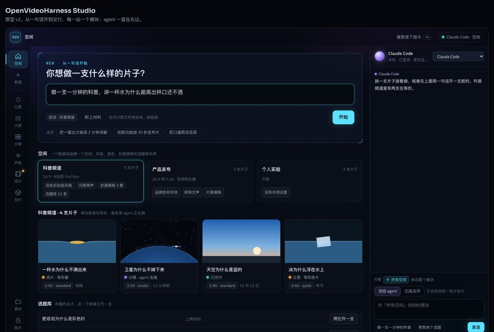
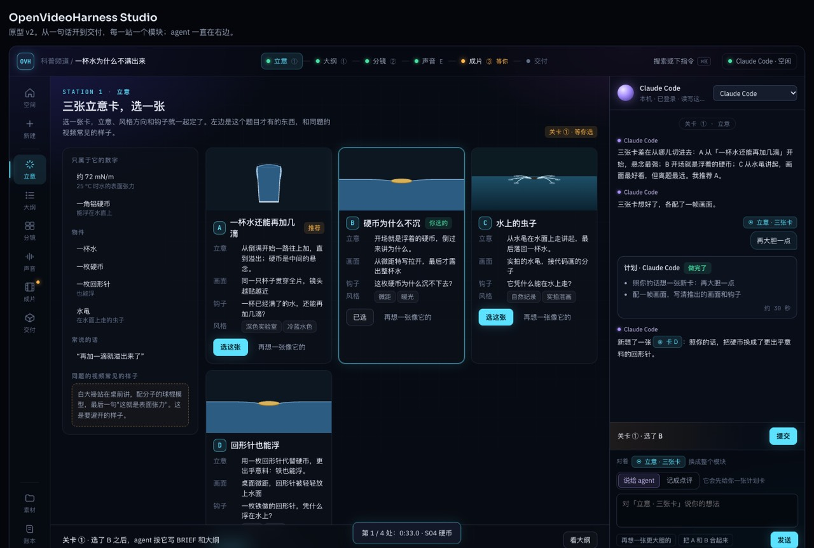
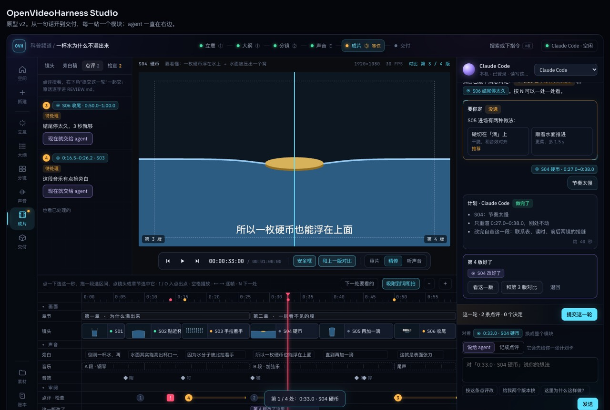

# 提案 02 · Studio：从一句话到交付的客户端，剪辑交给本机的 agent

*2026-10-19 · 状态：方向认可，细节待定（2026-10-19）。维护者看过可以点的原型后说"有点意思了"，UI 样式要更与众不同，细节到正式开发时再打磨。这个 PR 只加了这份文档和原型，工具和流程都没改。2026-10-20 补了第 1.1 节 HyperFrames Studio：维护者说，客户端的重点是 agent 交互这层 harness，别的产品有、对我们有用的照样学，开源的部分可以直接拿来改，不只是做它们没有的。*

**起因。** 维护者提了四件事：

- 审阅页要好看，现在的页面逻辑乱、不够直白；
- 已经有人做出了可视化客户端，有的像剪映那样能在窗口里剪，有的带 AI 编辑器，我们也要有；
- CLI 继续完善，同时包一个产品出来，在客户端里调用本机的 Claude Code、Codex、DeepSeek 等 agent；
- 不只是看成片：从零开一个项目也要支持，空间、素材、立意、从一句话开始、审大纲，都要有对应的界面。

时间轴要能清楚地拖动、显示画面，每个分镜能单独点评、让 agent 优化，但不做完整的自由剪辑平台。

这份提案接着[提案 01](01-client-and-workflow.md) 往下走。01 定了路线 C：导演台加一层开放的片子层，剪辑器借现成的；`film.html` 只当交换格式，人在 Studio 里的改动作为 overrides 回到我们的出片路径；不做 key 的设置页。这些都照旧。

## 先说结论

1. **人只做四件事：看、指、说、定。** 看：拖播放头、逐帧走、和上一版对比。指：选中全片、一章、一镜、一段或某一秒，或者大纲的一段、一张立意卡、一件素材。说：对着选中的部分跟 agent 说，或者记一条点评攒成一轮。定：在计划卡上点开始，在结果卡上接受或退回，在"要你定"的卡上选一个。改片子的活都交给 agent，手动只做看、选、比。
2. **一个外壳，十个模块。** 左边是模块栏，顶上是流程条，右边是一整列 agent。中间的模块按站排：空间、新建、立意、大纲、分镜、声音、成片、交付，再加素材和账本两个库。每个模块都是同一套"看、指、说、定"。
3. **项目文件和 CLI 是真相，客户端只是一层壳。** 客户端做的每一步都对应一条 `bin/vh` 命令或一个项目文件；不开客户端，用 CLI 加 agent 照样能做完一支片子。客户端里能用的功能，先做进 CLI。
4. **agent 接本机已经登录的那个。** 客户端不自带模型、不存 key；用 ACP 这类协议或 agent 自己的无头模式，接 Claude Code、Codex 等。接通之前，现有的 `bin/vh desk wait` 文件通道就能用。
5. **我们的特色是"片子懂自己的结构"。** 别家的时间轴上是素材片段；我们的泳道是片子自己的数据：镜头和它要观众看懂的 reads、旁白、音乐小节、音效、检查告警、这一版改了哪儿。画面由页面合约的 `frame(t)` 实时画出，任意两版的同一帧可以逐像素比；agent 改完只重渲改过的那几段（`bin/vh patch`）。
6. **力气花在 agent 交互的 harness 上，界面能借就借。** HyperFrames Studio 已经做出一个驱动本机 Claude Code、Codex 的视频编辑器，交互和这份提案想的很像（第 1.1 节）。它和别的产品有、对我们有用的，照着学；开源的部分（HyperFrames 的 `packages/studio` 是 Apache-2.0，OpenFilm 是 MIT）能直接拿来改的就改，不从零写。我们自己做的是 harness 这一层：站和关卡、谁来拍板、计划卡和结果卡、按片子结构排的泳道、检查告警、多引擎、事实和许可的底线。

原型：[`figs/02-studio-prototype.html`](figs/02-studio-prototype.html)，用浏览器直接打开就能点；里面的片子、数字和 agent 的回复都是编的示例。

---

## 1. 参考了什么

只借经过验证的交互模式，不照搬功能。

| 产品 | 借什么 | 我们的不同 |
|---|---|---|
| DaVinci Resolve | 底部的页面条：同一个项目，按阶段换工作区 | 每一站就是一道关卡，轮到人时那一站亮"等你" |
| Frame.io | 带时间码和区间的点评，版本堆叠和对比（V4 的功能对照表里有区间点评、标注、版本对比、版本堆叠） | 检查工具的告警也挂在出问题的那一秒；点评按轮提交，原话逐字进 `REVIEW.md` |
| Descript | 稿子就是时间线 | 点一句旁白，就选中它念的那一段 |
| Final Cut | 按角色分色的泳道、吸附、扫过就预览 | 选区间时吸附到词、镜头边界和拍 |
| Cursor 这类 AI 编辑器 | 选中的就是上下文；改完接受或退回 | 选中的单位是片子的结构，带上那一部分的 reads |
| Premiere（2026-09） | 据报道，新的生成工具是"在轨道上划一段，描述你要什么" | 印证"选中一段再说"这条路；我们改的是代码，不是生成素材 |
| ChatCut | 用对话改真实的时间线；动手前给一张带估计的确认卡 | 我们的计划卡写清动哪几镜、只重渲哪几段 |
| OpenChatCut | 本地优先，接 Codex、Claude Code 和 MCP agent | AGPL 许可，只借思路，不碰代码 |
| AutoClip | 桌面端是 Tauri 套本地 FastAPI 和 React，CLI、MCP 和桌面端共用一条流水线；候选加备选；出错按阶段报；按平台出发布包（MIT 许可） | 和"CLI 是真相、客户端是壳"一致；它有填 API key 的设置页，我们不做 |
| OpenFilm | 桌面端用 ACP 驱动本机 agent；对话里的提问卡；Studio 里的改动写回项目 | 提案 01 已经记下，这次接着用 |
| HyperFrames Studio | 驱动本机 Claude Code、Codex 的桌面编辑器：在画面上选中、圈画、评论，在时间轴上划一段说话，改动攒着一次发，每次运行可以单独撤销 | 交互照着学，开源的编辑器组件可以直接改来用；见第 1.1 节 |

链接：[Frame.io V4 功能对照](https://help.frame.io/en/articles/9084073-frame-io-v4-legacy-feature-comparison)、[Adobe 2026-09 的 Premiere 更新](https://blog.adobe.com/en/publish/2026/09/08/generate-create-directly-in-your-timeline-with-new-ai-powered-innovations-in-premiere-after-effects)、[ChatCut 文档](https://chatcut.io/docs/quickstart)、[OpenChatCut](https://github.com/0xsline/OpenChatCut)、[AutoClip](https://github.com/zhouxiaoka/autoclip)。这几个仓库没有拉进 `references/`。

### 1.1 HyperFrames Studio

HeyGen 的桌面应用（Mac、Linux），见 [hyperframes.dev/studio](https://hyperframes.dev/studio) 和仓库里的[应用文档](https://github.com/heygen-com/hyperframes/tree/main/docs/studio-app)。它和这份提案想做的最接近：

- **agent**：用本机的 Claude Code 或 Codex。Claude Code 可以替人装好、登录；用量算在人自己的 agent 账号上，也可以改用 API key。agent 的状态分"就绪 / 没登录 / 没装 / 装了起不来"，每种配一个修复按钮；用量到上限时提示换另一个。
- **三种"指"**：选中画面里的元素再描述（V），在画面上圈画（D），在某处某一秒钉一条评论（C）；在时间轴上划一段，说"这段收紧"。右键元素有快捷操作。
- **攒着一起发**：选中、圈画、评论不马上执行，先进"待发送的修改"（最多 10 条），检查、加一句总的说明，再一次发出。agent 在跑时再发，默认排队，也可以改成打断重来。每次运行有自己的撤销。
- **也能手动**：分割、删除、拖动裁剪，调速度、音量、淡入淡出；右键一段空隙，可以关掉，也可以问 agent 这里该放什么。
- **起步**：一个"第一支片子"的卡片，从 Hook、Proof、Turn、CTA 四段里各挑一个真实片段，加上网址或想法就生成；还有一个真实片段的灵感库，可以加进消息当参考；一个小向导（Framey）指出下一步。
- **导出**：1080p 或 4K，MP4、WebM、MOV，24、30、60 帧。

哪些开源：仓库是 Apache-2.0，编辑器 `packages/studio`（React：时间轴、代码编辑、实时预览、检查器，还有给 agent 调用的工具接口 `src/webmcp`）和 `packages/studio-server` 在里面；桌面应用的外壳不在仓库里，仓库只有"在桌面版打开"的按钮和启动它的代码。

**我们拿什么**：

- 交互照着学：待发送修改的列表和一次发出（和我们"攒成一轮"是一件事），排队或打断，每次运行单独撤销，在画面上圈画，右键快捷操作，agent 状态和修复按钮，导出面板。
- 起步和灵感：它的灵感库和四段式起步卡，我们有现成的料可以对上：`recipes/`、`cases/`、`styles/` 和 `recipes/sequences/` 的全片骨架。
- 组件能用就用：时间轴、播放器、检查器先看 `packages/studio` 能不能接上我们的页面合约；能改来用就改，按 Apache-2.0 保留 NOTICE、在改过的文件里写明改动。它的 agent 工具接口（WebMCP）也值得看，我们的模块可以照样把"选中、跳转、出计划"暴露给 agent。

**我们的侧重**：它是"会写视频的 agent 加一个编辑器"，我们是"一套做片的工作流，人和 agent 在里面配合"。所以多出来的是：站和关卡、谁来拍板、计划卡（先说动哪几镜、只重渲哪几段）、按片子结构排的泳道（reads、cue、时间映射、检查告警）、多引擎（canvas-film、手绘、Manim，不只 HyperFrames）、事实和许可的底线。几处不跟：它要厂商账号，默认给 agent 完全访问（能装东西、上网、跑任何命令），带使用数据记录；我们的客户端不要账号，权限跟 agent 自己的设置走，不收集使用数据。

**顺带的兼容**：用 HyperFrames 引擎的项目守它的时间轴约定（字幕一条轨、一条轨一类东西、每个场景是子合成），就能直接在 HyperFrames Studio 里打开；里面的 Claude Code 在项目文件夹里跑，照样读我们的 `CLAUDE.md`、调 `bin/vh`。这是附带的好处，不是我们客户端的替代。

## 2. 外壳

- **模块栏（左）**：空间、新建；立意、大纲、分镜、声音、成片、交付；素材、账本。有一站在等人时，那个模块上亮一个琥珀色的点。
- **流程条（顶）**：立意 ① · 大纲 ① · 分镜 ② · 声音 · 成片 ③ · 交付。灯的颜色：绿是过了，琥珀是在等你，紫是 agent 正在做。点一站就到那个模块。
- **agent 栏（右，一整列到底）**：
  - 顶上写着用的是哪个 agent、它现在在干什么；
  - 中间是对话，有这几种卡：你说的话（带着"对着什么"）、计划卡、进度、结果卡、"要你定"的卡；
  - 底下是输入框，带"说给 agent / 记成点评"的切换；"对着"跟着你在模块里点中的东西变；
  - 有关卡在等时，输入框上面多一条汇总："这一轮 2 条点评 · 1 个决定 [提交]"。
- **⌘K 命令面板**：照 Linear、Raycast 的做法，敲一句话直接带着上下文发给 agent。

agent 怎么接活，每个模块都一样：

1. 你选中一样东西，说一句话；
2. agent 回一张计划卡：要改什么、只动哪些文件或哪几段、大概多久。小事也出卡，你点"开始"才动；
3. 做的过程中，那一段在时间轴上显示进度，模块栏和流程条亮紫灯；
4. 做完回一张结果卡：看这一版、和上一版对比、退回。退回就是换回上一版，新的一版还留着。

点评模式下，话先攒着，不立刻交给 agent；点"提交这一轮"时一起交，原话逐字记进 `REVIEW.md`，和现在审阅台的提交一样。

## 3. 十个模块

| 模块 | 人看到什么 | 人做什么 | 背后是什么 |
|---|---|---|---|
| 空间 | 一个频道或品牌一个空间，共用风格、音色、封面模板、选题库；空间里的片子带状态灯；顶上一个大输入框"你想做一支什么样的片子？" | 打开一支片子接着做；用一句话或选题库里的点子开新片 | 新概念，见第 6 节 |
| 新建 | agent 照一句话填的方案：类型、在哪看、规格、时长、档位、谁来拍板（逐项"你定 / 给你看 / 交给 agent"）；最多三个问题；估计；对应的命令 | 改方案，回答问题，点"建项目" | `bin/vh new`、BRIEF 的 `Effort:` 和 `Director:` |
| 立意 | 左边是素材清单（只属于这个题目的数字、物件、常说的话）和"同题的视频常见的样子"；右边是 2–3 张立意卡，各配一帧画面，写着立意、画面、钩子、风格 | 选一张；"再想一张像它的"；写自己的立意 | `playbook/12-ideation.md`、关卡 ① |
| 大纲 | 按时长比例的段落条和段落卡（段名按内容起）；BRIEF；引擎和花费 | 点一段单独说；审 BRIEF | 关卡 ① |
| 素材 | 每件素材都带许可、来源、用在哪一镜；许可没写清的标出来 | 拖文件、贴链接，或者让 agent 去找（只拿许可写清的） | `NOTES.md` 的素材许可 |
| 分镜 | 按段落分页；灰盒 animatic 可以播；每镜写着 reads、转场，没把握的标出来 | 点一镜单独说 | 关卡 ②、`shots.json` 或 `window.film.shots` |
| 声音 | 响度、真峰值、语速、静音的读数；几个音色读同一段话的对比；逐句语速；配乐能量曲线和候选落点 | 换音色（先出计划卡）；点一句重念 | `voices audition`、`pace --dry-run`、`tts --candidates`、`beats` 的 `lifts`、`qa` |
| 成片 | 见第 4 节 | | 关卡 ③ |
| 交付 | 竖、横两张封面；各平台标题、简介、章节、标签；会出什么；出片前检查 | 点一张封面或一条文案单独说；出片 | `bin/vh deliver`、`check`、`cover-preview` |
| 账本 | 决定（谁定的、什么时候、为什么）；你的原话；版本 | 对 agent 定的事翻案，翻之前它先说要重做哪几站 | `DECISIONS.md`、`REVIEW.md` |

## 4. 成片模块：时间轴工作台

布局按维护者在第一版原型截图上圈的来：

- 左边是四个清单：镜头、旁白稿、点评、检查；
- 中间是画面；
- 下面是时间轴，只铺在左边和中间下面；
- 右边是 agent 一整列。

画面下那条"选中"栏删掉了：时间轴上已经高亮了选中的部分，输入框上也写着"对着什么"，同一件事不用显示三遍。

- **画面**：暂停时用 `frame(t)` 画准确的那一帧；快速拖动和播放时可以换成低清代理视频，重渲过的段落随时换进去。画面按高度撑满，四周是中性深灰。顶上一行等宽读数：镜头、要看懂、分辨率、帧率、第几版。播放条浮在画面下方（不压在画面上，免得挡字幕）。
- **选中的单位**：点一下是某一秒，拖一段是区间（吸附到词、镜头边界和拍），点镜头块或章节块就选中它，旁白稿里点一句就选中它念的那一段；I / O 设入点出点。选中区上方标着它是什么、多长。
- **泳道**：分画面、声音、审阅三组，可以折叠。
  - 画面：章节、镜头（带缩略图和状态点）；
  - 声音：旁白、音乐（段落和小节线）、音效；
  - 审阅：点评和检查的标记、这一版改了哪几段，重渲中的段落显示进度。

  点评和告警也在标尺上打点。
- **三种布局**：审片（两侧收起，时间轴只留镜头和标记）、精修、听声音（声音泳道变高、带波形）。关卡 ③ 一打开先进审片布局，人第一次看片不该被面板打断。
- **下一处**：agent 自己最不满意的几处和检查告警排成一队，按 N 一处一处跳。
- **版本**：agent 每改一次就是一版，记着改了哪几段；任意两版可以擦除对比；退回就是换回上一版。
- **手动只做看、选、比**：拖动、裁剪、调速、换顺序都写成话交给 agent。能直接写回数据的小改（挪一个切点、改一个错字），以后看需要再加，写回的是 cue、事件表这些数据，不是像素。

## 5. 视觉

原型用的是"深空玻璃加仪器读数"（维护者选的 A 和 B 合起来）。几条规矩：

1. **玻璃只用在外壳和浮层**：顶栏、模块栏、agent 栏、浮在画面下的播放条。时间轴、清单、表格用实底，小字读得清。
2. **画面四周保持中性灰**：调色软件这样做，是为了不让界面颜色影响人对画面颜色的判断。深空色晕和网格只留在窗口边缘。
3. **读数用等宽字**：时间码、帧率、响度、语速、音高。青色括角只用在画面、BRIEF、读数和"要你定"的卡上。
4. **颜色只说"是谁、在发生什么"**：青是人选中和标记的，紫是 agent 做的，红是正在发生的（播放头、出错），琥珀是在等人。其余都是灰。
5. **只做深色**：刻意的单一风格，专业剪辑软件也都是深色。

**待打磨**：维护者认为样式还可以更与众不同。正式开发前再做一轮风格探索，给两三个方向的同一块界面（画面、一段时间轴、一张 agent 卡）对比着挑；上面五条里，第 2、4 条是可用性上的要求，换风格也保留。

## 6. 空间

空间是这次新加的概念：一个频道或品牌一个空间，放所有片子共用的东西。

- 风格（`STYLE.md` 和 tokens）、默认音色、封面模板、片头片尾、平台规格；
- 选题库：存着的点子，点一下就拿它开新片；
- 空间里的片子列表，每支带状态灯：在等人、agent 在做、已交付。

新片子建在空间里，继承这些设置，项目里照样可以改。怎么落到文件上（一个空间一个文件夹，还是一份配置文件指向几个项目文件夹），正式设计时再定；要守的是：项目文件夹本身仍然自足，拷走就能用 CLI 做完。

## 7. 架构

- **真相在项目文件夹里**：BRIEF、STORYBOARD、`shots.json`、时间轴、事件表、时间映射、`REVIEW.md`、`DECISIONS.md` 和 `out/`。客户端只读写这些文件、调用 `bin/vh`；客户端里有、CLI 里没有的能力，先补进 CLI。
- **本地服务**：从 `bin/vh desk` 长出来。它已经有只绑 127.0.0.1、令牌、沙箱化的 `/p/` 文件服务、提交写 `REVIEW.md` 这些基础。
- **画面**：读页面合约 `window.film`（`frame(t)`、`duration`、`shots`、`chapters`、`cues`、`texts`、`events`、`music`、`timemap`），不需要先渲染。
- **agent**：
  - 第一步走文件：人提交，客户端写反馈 JSON，`bin/vh desk wait` 交给终端里的 agent；
  - 第二步用 ACP 或 agent 自己的无头模式，把对话接进 agent 栏。各家 agent 的接入方式变得快，开工前要核实；
  - DeepSeek 这类模型，走能换模型的 agent（比如 OpenCode）。
- **key**：客户端不存。硬规则 7 不改。
- **界面组件**：时间轴、播放器、检查器先评估 HyperFrames 的 `packages/studio`（Apache-2.0）和 OpenFilm 的 Studio（MIT）；能接上页面合约的就直接用或 fork 改，保留许可和 NOTICE，写明改动。
- **桌面外壳**：先做本地网页；用了一阵再用 Tauri（AutoClip 走的就是这条路）或 Electron 打包。

## 8. 不做什么

- 多轨自由剪辑、素材时间线编排、特效面板、关键帧曲线。真要手剪的片子，导出给别的剪辑软件；`film.html` 交给 OpenFilm Studio 的路，提案 01 已经写了；
- 自带模型、key 的设置页；
- 云端多人协作。以后真要做，再单独写提案。

## 9. 分期

每一期单独能用：

1. **成片和关卡**：本地客户端的外壳加成片模块（画面、语义时间轴、清单、点评、按轮提交），替换现在的静态审阅页和审阅台的 10 个页签；agent 先走文件通道。开工前先评估 `packages/studio` 的时间轴和播放器能不能直接改来用。
2. **agent 栏接通**：ACP 或无头模式，接 Claude Code 和 Codex；计划卡、进度、结果卡、退回。
3. **从零开始**：空间、新建、立意、大纲。
4. **其余模块**：素材、分镜、声音、交付、账本。
5. **桌面应用**：打包，一键安装。

## 10. 还要定的

1. 第一期先做哪几块：推荐成片和关卡，因为每支片子都要用、马上见效。
2. 风格探索放在第一期开工前，还是做出可用的骨架之后。
3. 空间落到文件上的方式（第 6 节）。
4. agent 接入：先接哪几家；ACP 的现状开工前核实。
5. 桌面外壳：Tauri 还是 Electron。
6. 从 HyperFrames Studio 拿多少：直接依赖它的包、fork 一份改，还是只借交互。

## 附录：原型

- 文件：[`figs/02-studio-prototype.html`](figs/02-studio-prototype.html)，单个 HTML，字体从 Google Fonts 加载（离线时用系统字体）。
- 能点的：模块栏和流程条切模块；空间页"开始"进入新建；新建里改档位和"谁来拍板"，"建项目"后 agent 想立意；立意选卡、再想一张；大纲点段落；素材筛选；分镜翻页、播灰盒；声音换音色（先出计划卡）；成片里点、拖、选，发一句话，点开始，出新的一版，对比、退回，按 N 跳下一处；交付切平台文案；账本翻案。
- 原型里所有模块用同一支编出来的 60 s 示例片。
