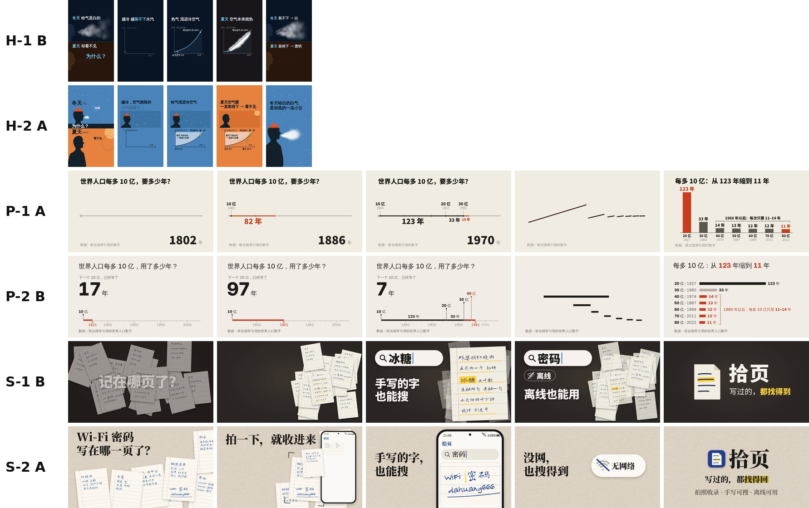

# 10 · 不用引擎：同一句需求，自己写页面对走默认流程

*记录于 2026-11-27 · 状态：本笔记和"不用引擎"这条路（`bin/vh new … --engine page`）在同一个 PR 里；六支片子、项目和评审记录是作者本地的文件，没有入库 · [English](en/10-page-vs-workflow.md)*

## 问题

同一个 PR 加了一条"不用引擎"的路：片子就是 agent 自己写的一个页面，只守页面合约（`engines/CONTRACT.md`）。开工前只读一张约 4,300 字的说明卡（`engines/page/README.md`）和底线，类型文档、playbook、配方、风格都按需查。按 `tools/readpath.py` 的估算，`quick` 档开工前要读的从 3.9 万–8.4 万字降到约 3.3 万字。研究笔记 06 比过"只守底线"和"走流程"，但那次两组都用 HyperFrames，只守底线的一组还读了 `engines/README.md` 的 HyperFrames 一节。这次要回答两件事：

1. 用户说"怎么做你自己定"，agent 会不会走上这条路？
2. 走这条路做出的片子，和走默认流程的比，点子和做工差在哪？默认流程的必读能不能因此减？

## 做法

- **需求**：三句，都是用户常发的那种。H：冬天呼出的气为什么是白的，竖屏，发抖音；P：世界人口每多 10 亿用了多少年，横屏，发 B 站，八个数字写在需求里；S：虚构 App"拾页"的发布短片，横屏，发视频号，三个卖点写在需求里。都要配乐和音效、不要旁白（做片的机器连不上配音服务，也没有 key），静音也要看得懂，都说"快速出一版，不用问我"，也就是 `quick` 档。
- **两组**：A 组在原话末尾加"怎么做你自己定，不用照模板，也不用现成的引擎"；B 组就是原话，按默认路由走（这三类的首选引擎都是 HyperFrames，读 quick 卡和类型文档的两节）。
- **机器**：一台云端容器，Ubuntu 24.04.5，x86_64，4 核，15 GB 内存，没有 GPU，Chrome for Testing 158。常用的 Python 包、HyperFrames 的包和它的浏览器事先下载好。做片的六个子代理和盲评用同一个模型；每支片子在自己的 git 工作树里做，各给约 40 分钟。
- **盲评**：一个全新上下文的子代理，只拿到六支片子，按组编号（H-1、H-2、P-1、P-2、S-1、S-2），不知道哪支属于哪组，也不知道这是对照实验。每支给 mp4、每秒一帧的联系表、按 BRIEF 的 `Watch on` 缩的联系表（phone、feed 每格 360 px 宽，desktop 640）、前 3 秒逐帧、`bin/vh check` 的结果，以及三句需求的原话（不含 A 组加的那句）。它按打分层的八个维度打分（1–10），再每组两两比较：哪支更有新意、哪支做得更好、只能发一支发哪支、核心点子有多像（0–10）。它听不到声音，"声画同步"六支都给 6 分，不参与比较。
- **静止段**：和 06 同一个口径（480×270 灰度，相邻两帧的平均差小于 0.3/255 记为静止，只数连续 2 秒以上的段）。
- **中途两次重开 A 组**：第一次，子代理自带的隔离工作树是从 `main` 开出来的，A 组根本没有这条路，跑了约 15 分钟后停掉；第二次在带这条路的提交上重开，"不用引擎"当时写在路由表下面的一段里，A 组只说"怎么做你自己定，不用照模板"，4 分钟里建了项目的两支都选了 HyperFrames，停掉。把这条路挪进路由表第一行、需求里再加"也不用现成的引擎"以后，三支都走了这条路，下面的结果都是这一次的。

来源：六个子代理的交付报告和结束时的用量记录（用时、token、工具调用）；六个项目的 `BRIEF.md`、`DECISIONS.md` 和成片；盲评报告；静止段用上面的口径对六个 mp4 重算。

## 发现

*图 1 · 每行一支片子，取片长 10 %、30 %、50 %、70 %、90 % 五个时刻。H-1、P-2、S-1 是 B 组（默认流程），H-2、P-1、S-2 是 A 组（不用引擎）。*

**1. 走哪条路，点子几乎一样。** 评审给三组核心点子的相似度是 8、9、8（满分 10）。H 组两支都是冬夏上下分屏，再画饱和曲线和混合线；P 组两支都让片子里的时间匀速走过年份，再把每段等待竖成柱子，最后的大标题一字不差（"每多 10 亿：从 123 年缩到 11 年"）；S 组两支都用"找写着 Wi-Fi 密码的那一页"来演离线，口号只差一个字。06 那次只有一对相似度 8/10。

**2. 新意和做工互有胜负，平均分分不出高下。**

| 片子 | 组 | 立意 | hook | 目标屏可读 | 运动质量 | 变化 | 构图与完成度 | 内容准确 | 平均（含声画同步） |
|---|---|---|---|---|---|---|---|---|---|
| H-1 | B | 7 | 6 | 7 | 6 | 6 | 6 | 7 | 6.38 |
| H-2 | A | 8 | 7 | 8 | 7 | 7 | 7 | 8 | 7.25 |
| P-1 | A | 7 | 5 | 8 | 7 | 6 | 7 | 9 | 6.88 |
| P-2 | B | 8 | 6 | 8 | 7 | 7 | 8 | 9 | 7.38 |
| S-1 | B | 8 | 7 | 8 | 7 | 8 | 8 | 8 | 7.50 |
| S-2 | A | 7 | 5 | 8 | 6 | 6 | 7 | 8 | 6.63 |

| 组 | 更有新意 | 做得更好 | 只能发一支 | 相似度 |
|---|---|---|---|---|
| H | A（H-2） | A（H-2） | A（H-2） | 8 |
| P | B（P-2，略胜） | B（P-2） | B（P-2） | 9 |
| S | A（S-2） | B（S-1） | B（S-1） | 8 |

A 组三支平均 6.92，B 组 7.09。两两比较里，A 两次更有新意、一次被选去发；B 一次更有新意、两次被选去发。06 那次是走流程的两次更有新意、只守底线的两次被选去发，方向和这次正好相反。两次合起来看，这两条路在 `quick` 档分不出高下。

**3. A 组输在开头和停顿，B 组输在一处画错。** A 组的 P-1 和 S-2 的 hook 都只有 5 分：P-1 前 2.5 秒只有一条线和一个不动的年份，S-2 在 0.6–4.0 秒基本不动。按上面的口径，A 组三支 2 秒以上的静止合计 17.2 秒，B 组三支 7.2 秒，其中 P-2 和 S-1 是 0。B 组的 P-2 是看了 `bin/vh check` 报出片尾 3.4 秒定格以后，自己加了一段慢推。`bin/vh check` 的静止警告从 3 秒起算，P-1 开头约 2 秒的静止它不报。B 组的 H-1 有两处画错：夏天 30 °C 的点画在横轴约 20 °C 的位置，18.5–19.3 秒白雾残留在夏天那条线上，和"装得下所以透明"的结论自相矛盾。

| 片子 | 组 | 引擎 | 用时 | token | 工具调用 | 2 秒以上的静止 | 最长一段 |
|---|---|---|---|---|---|---|---|
| H-1 | B | HyperFrames | 22 分钟 | 28.7 万 | 97 | 7.2 秒 | 2.6 秒 |
| H-2 | A | page | 约 24 分钟（中断过） | 不全 | 不全 | 9.1 秒 | 4.1 秒 |
| P-1 | A | page | 19 分钟 | 23.2 万 | 78 | 2.1 秒 | 2.1 秒（开头） |
| P-2 | B | HyperFrames | 23 分钟 | 28.7 万 | 90 | 0 | 0 |
| S-1 | B | HyperFrames | 23 分钟 | 30.2 万 | 126 | 0 | 0 |
| S-2 | A | page | 约 24 分钟（中断过） | 不全 | 不全 | 6.0 秒 | 3.3 秒 |

**4. 路由要放在 agent 一定会看的地方。** "不用引擎"写在路由表下面的一段里时，说了"怎么做你自己定，不用照模板"的两支都照类型选了 HyperFrames，没读到那一段。挪进表的第一行、需求里再说"也不用现成的引擎"以后，三支都走了这条路。三支里有两支照说明卡先用三种明显不同的做法各画一帧再挑（H-2、S-2），一支只在心里比了三个方向（P-1）。

**5. 少读的那组也会按需去翻。** A 组没读 HyperFrames 那一节，但三支都打开了类型文档的几节（禁止、自查重点，有一支还读了 Prompt 增量块），三支也都打开了 quick 卡，因为 CLAUDE.md 第 0 步让所有 `quick` 片子去读它。能比的用量只有 P-1：23.2 万 token、78 次工具调用，B 组三支是 28.7 万–30.2 万 token、90–126 次。A 组晚开 20 分钟，那时机器上只剩 A 组在跑，用时不能直接比。

**6. 六支都过了检查，各自修过一处。** 六支的 `bin/vh check` 都没有失败。做片时自己修过的：S-1 的 `bin/vh determinism` 第一次只有 39.7 dB（纸张的 CSS 写了 `will-change`），删掉后重渲；P-2 修了片尾的定格；S-2 的 `bin/vh readcheck` 第一次有两段字停得不够。H-2 的做片人连不上维基百科，饱和水汽的数字凭记忆，所以片中只写"暖、湿"，没有写克数，待核的几条记在 NOTES。

来源：盲评报告（打分、两两比较、相似度、每支最该先改的一处）；静止段用上面的口径重算；六个子代理的交付报告和用量记录；六个项目的 `DECISIONS.md`、`NOTES.md`。

## 因此改了什么

- **路由**：`CLAUDE.md` 路由表的第一行是"不用引擎"，原来表下面那一段删了；第 0 步写明 `quick` 档走这条路时照说明卡做，不读 quick 卡。
- **默认流程的必读这次不减**：06 和这次都没有显示读得多的那组点子更新或做得更好，也没有显示更差；点子主要由模型自己定（相似度 8–9），差别落在开头和停顿这类做工上。要不要减，等更多数据；想少读的人走这条路。
- **没做、建议做**：把"开头静止"做成 `bin/vh check` 的一项警告。06 的四支片子开头都偏慢，这次 A 组有两支开头不动，现在只靠人去看前 2 秒的逐帧。

## 局限与没解决的

- **样本很小**：三组各一支，只跑一次，只比了 `quick` 档，没有旁白；评审是同一个模型扮的，听不到声音。
- **两组的需求不完全一样**：A 组多了"也不用现成的引擎"这半句。
- **两组的条件不完全一样**：B 组跑在旧的提交上（路由表还没有这一行，对 B 组走的那条路没有影响），A 组晚开 20 分钟，机器负载不同；H-2 和 S-2 中途碰上用量上限，停了 4 个多小时才接着做，用量记录不全。
- **没试过"只说自己定"加上新的路由**：路由挪进表第一行以后，没有再用不加"也不用现成的引擎"的原话试一次。
- **一点交叉**：P-1 的做片人把下载的字体放进了一个别的做片人也在用的文件夹，它说只看到了目录名，没有打开里面的文件。
