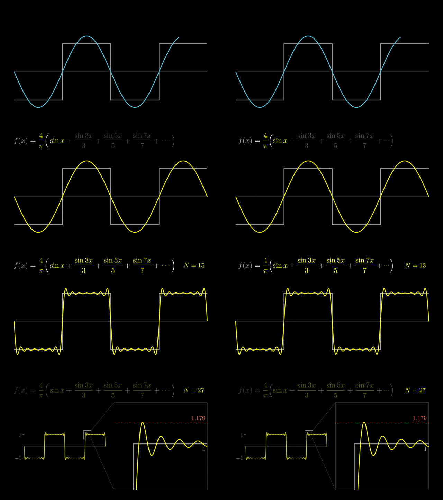

# 08 · ManimGX as a Manim backend: showcase 03 moved over, the lines it took, how alike, how fast

*Recorded 2026-10-29 · Status: ManimGX 0.1.1 is registered as an optional backend in this note's PR (`tools/modules.json`, reported by `bin/vh doctor`); Manim CE stays the first engine for types 01 and 06 · [中文](../08-manimgx.md)*

## Question

ManimGX takes scenes written against Manim CE's Python API and renders them on a Rust and wgpu core. Its README says that over five 1080p60 scenes on an Apple M4 Pro it is "90.6× faster than ManimCE", from launch to finished MP4, every engine at its fastest encoding preset (which five scenes, it does not say). Moving this repo's showcase 03 (a square wave from sine waves, 25 s, Manim CE 0.21) over as it is: how many lines change, how alike are the pictures, how much faster is it, and can its file go straight into the repo's pipeline?

## Method

- One machine (M3 Max, macOS 15.8), one `scenes/` folder: Manim CE 0.21.0 / Python 3.12 (uv), `-qh --fps 30 --disable_caching`; ManimGX 0.1.1 / Python 3.13 (uvx, outside the project's environment), `-r 1920x1080 --fps 30`. Each rendered twice, the second run timed, with the LaTeX, shader and font caches warm.
- Changed only as far as it took to run (finding 1).
- The pictures: ManimGX's film re-timed to a constant 30 fps and compared with CE's frame by frame by PSNR: at full size, both converted to RGB, with ffmpeg's psnr filter; and again at 480×270, each film decoded to full-size RGB first and then shrunk by area averaging, which smooths the strokes' anti-aliasing. Each frame matched to the most alike frame of the other within 12 frames either side, to see whether the two draw the same moment at the same time; 3, 8, 16 and 20 s side by side (figure 8.1).
- The files: frame counts, length, colour tags; `bin/vh check`; whether two ManimGX renders give the same frames.

## Findings

1. **What changed**: every `from manim import …` in the scene and its helper modules becomes `manimgx`, here two of them (`fourier.py`'s `from manim import *` and `style.py`'s `from manim import VMobject, ManimColor, config`); ManimGX exports a shape called `Path`, which shadowed the `pathlib.Path` the file imports first (the scene's `Path("out/check/…").unlink()` failed), so pathlib is imported again after the star import; `rate_functions.ease_in_out_sine` becomes the top-level `ease_in_out_sine` (there is no `rate_functions` module). Four changes in all. 0.1.1's star import brings `np` along, so an explicit `import numpy as np` is not needed. The rest runs as it is: `always_redraw` with its `z_index` fix, `ValueTracker`, per-part colouring of `MathTex`, `Brace`, `DashedLine`.
2. **About 5× as fast**: on the second run CE took 18.3 s, ManimGX 3.6 s (its own log says 3.0 s of rendering, the rest is start-up); on the first, CE 37.8 s (LaTeX compiling) and ManimGX 3.7 s. The README's 90.6× was measured otherwise: 60 fps against 30, the fastest encoding preset against each tool's default (ManimGX's is CRF 23, medium), an M4 Pro against an M3 Max, and other scenes, so the two factors do not compare directly.
3. **Plainly the same film, not the same pixels**: per-frame PSNR at full size has a median of 25.8 dB (lowest 16.9); at 480×270 the median is 31.6 dB, and 27.5 dB over the frames where the picture moves ("moves": the CE frame differs from the one before by more than 0.5 of 255 per channel on average, at 480×270 RGB; 148 of the 750 frames). Most of it is typesetting and strokes: Typst sets the equation, so the brackets and the ellipsis have other shapes and spacing than LaTeX's, and the curves' strokes are anti-aliased differently. In time: each frame's most alike frame of the other within 12 frames either side is, in the median, offset by 0; the plays start less than half a frame apart (CE's partial movie files against `manimgx inspect`'s timeline). Yet on the same frame at 16 s, CE's counter reads N = 15 and ManimGX's 13, one step apart (figure 8.1, third row); why was not found.
4. **Its file needs conforming before the repo's pipeline takes it**: ManimGX writes a variable-frame-rate MP4, a held picture as one long frame (482 frames in 25 s, the last one 2.63 s long), plus one frame at the scene's very end (751 frames once re-timed to 30 fps, against CE's 750); its colour is a BT.601 matrix, tagged `smpte170m` with sRGB primaries. The repo's tools each take it their own way: an edit list refuses a variable-rate file; `bin/vh mux` copies the video stream as it is, frame rate and colour untouched; `bin/vh check` warns of the colour tags only, not of the variable rate, and counts the file's own frames and length (482 frames, 16.07 s; changed since, #170). One ffmpeg pass (cut to the scene's length, `fps=30`, BT.601 to BT.709, tagged; the command is in `engines/manimgx.md`) and `bin/vh check` passes: 750 frames, 25.00 s, BT.709, with the same notes as the CE film (the black opening, the still 1–4 s). The same frame at 8 s before and after, each decoded to RGB by its own colour tags: 44.9 dB. Frames taken by time should come from the conformed file too: on the original, `-ss 24.5` falls inside the last long frame and yields no picture.
5. **Two renders give the same frames**, byte for byte once decoded (per-frame md5), on this machine's GPU.

Figure 8.1 · Manim CE 0.21 (left) and ManimGX 0.1.1 (right) at 3, 8, 16 and 20 s. The equation's glyphs and spacing differ; at 16 s the counter reads 15 on one side and 13 on the other.

## What changed in the repo

- `tools/modules.json` registers `manimgx`, pinned at 0.1.1, installed as a uv tool; `bin/vh doctor` says whether it is there and whether it is the pinned version (doctor now holds programs to their pin too, not only npm packages).
- A new `engines/manimgx.md`: how to install it, the lines a scene changes, how to conform its film, what to watch in timing and licence; `engines/README.md`'s Manim section points to it in one line (about 60 more characters read for types 01 and 06 at every level).
- The first engine of types 01 and 06 is unchanged. Whether a project switches is the project's call, written into its `DECISIONS.md`.

## Still unclear

- Only one 2D film was compared. 3D scenes, long films and narrated scenes (its `self.say`) were not.
- Why the counter is one step apart at 16 s was not found: the plays' starts agree. A film whose beats must sit on the narration should have its timing checked again after a switch.
- On Linux without a GPU it renders through lavapipe; its speed and determinism there were not measured.
- Licence: by its README and LICENSE-THIRD-PARTY, ManimGX's own code is MIT, while its native wheels bundle x264 and are GPL-3.0-or-later as a whole. This repo's reading: installing it locally to render is unaffected, a scene that imports manimgx calls its MIT code and can stay under this repo's MIT, and the repo takes on no GPL obligations, so it carries no wheel. This is not legal advice.

Sources: measured on this machine, 2026-10-29 (showcase/03-math-fourier's `scenes/`, Manim CE 0.21.0 and ManimGX 0.1.1; the plays' starts compared again in the PR's review); ManimGX 0.1.1's README (its speed and licence sections), its LICENSE-THIRD-PARTY and its "Coming from Manim CE" page (manimgx.academa.ai).
