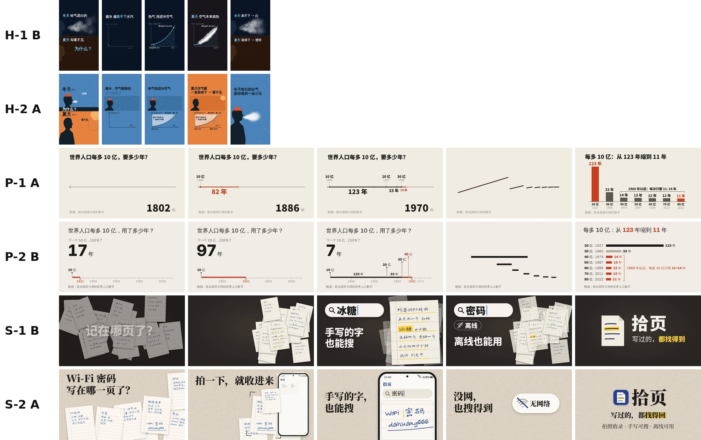

# 10 · No engine: one request, a page of the agent's own against the default workflow

*Written 2026-11-27 · Status: this note is in the same PR as the no-engine path (`bin/vh new … --engine page`); the six films, their projects and the review are the author's local files, not in the repository · [中文](../10-page-vs-workflow.md)*

## Question

The same PR adds a no-engine path: the film is one page the agent writes itself, held only to the page contract (`engines/CONTRACT.md`). Before it starts, the agent reads a card of about 4,300 characters (`engines/page/README.md`) and the floors; the type doc, the playbook, recipes and styles are looked up when needed. By `tools/readpath.py`'s estimate, what a `quick` film reads before it starts drops from 39,000–84,000 characters to about 33,000. Note 06 compared floors only against the workflow, but both of its groups used HyperFrames, and the floors-only group read the HyperFrames section of `engines/README.md`. This note asks two things:

1. When the person says "decide how yourself", does the agent take this path?
2. How do films made this way compare with the default workflow's, in idea and in craft? Can the default workflow's required reading be cut because of it?

## Method

- **Requests**: three, of the kind people send. H: why breath is white in winter, vertical, for Douyin; P: how many years each extra billion people took, landscape, for Bilibili, the eight figures given in the request; S: a launch short for a made-up app, 拾页, landscape, for WeChat Channels, its three selling points given. All with music and sound effects and no narration (the machine could reach no voice service and had no key), readable with the sound off, and all saying "a quick first version, don't ask me", that is the `quick` level.
- **Two groups**: group A adds "decide how yourself, no template, and no ready-made engine" to the request; group B gets the request as it is and follows the default routing (HyperFrames is the first engine for all three types, with the quick card and two sections of the type doc to read).
- **Machine**: a cloud container, Ubuntu 24.04.5, x86_64, 4 cores, 15 GB of memory, no GPU, Chrome for Testing 158. The usual Python packages, HyperFrames' packages and its browser were downloaded beforehand. The six film-making subagents and the reviewer ran on the same model; each film was made in a git worktree of its own, in about 40 minutes.
- **Blind review**: a subagent with a fresh context got only the six films, labelled by group (H-1, H-2, P-1, P-2, S-1, S-2), without knowing which group made which or that this was an experiment. For each it had the mp4, a 1 fps contact sheet, a sheet scaled to the BRIEF's `Watch on` (360 px a cell for phone and feed, 640 for desktop), the first 3 s frame by frame, `bin/vh check`'s result, and the three requests as sent (without group A's extra words). It scored the scoring layer's eight dimensions (1–10), then compared each pair: which is more novel, which is better made, which to publish if only one, and how alike the core ideas are (0–10). It could not hear the films, and gave all six a 6 for sync, left out of the comparison.
- **Still stretches**: measured as in 06 (480×270 grey, a frame pair is still when the mean difference is under 0.3/255, only runs of 2 s or more counted).
- **Group A was started twice more**: the first time, the subagents' own isolated worktrees were made from `main`, so group A had no such path; it was stopped after about 15 minutes. The second time it ran on the commit with the path, which was then a paragraph under the route table, and group A said only "decide how yourself, no template": the two runs that had made a project within 4 minutes both chose HyperFrames, and it was stopped. With the path moved into the route table's first row and "no ready-made engine" added to the request, all three took it; the results below are from that run.

Sources: the six subagents' hand-over reports and their usage records at the end (time, tokens, tool calls); the six projects' `BRIEF.md`, `DECISIONS.md` and films; the review; the still stretches measured again on the six mp4s as above.

## Findings

*Figure 1 · One film a row, at 10 %, 30 %, 50 %, 70 % and 90 % of its length. H-1, P-2 and S-1 are group B (default workflow); H-2, P-1 and S-2 group A (no engine).*

**1. Either path, nearly the same idea.** The reviewer rated the three pairs' core ideas 8, 9 and 8 alike (of 10). Both H films split winter over summer, then draw a saturation curve and a mixing line; both P films let film time run through the years at a constant speed, then stand each wait up as a bar, and end on the very same headline ("每多 10 亿：从 123 年缩到 11 年"); both S films show offline search with "the page the Wi-Fi password is written on", their slogans one character apart. In 06 only one pair was 8/10 alike.

**2. Novelty and craft each went both ways, and the mean scores do not separate them.**

| Film | Group | Concept | Hook | Target screen | Motion | Variety | Composition | Accuracy | Mean (with sync) |
|---|---|---|---|---|---|---|---|---|---|
| H-1 | B | 7 | 6 | 7 | 6 | 6 | 6 | 7 | 6.38 |
| H-2 | A | 8 | 7 | 8 | 7 | 7 | 7 | 8 | 7.25 |
| P-1 | A | 7 | 5 | 8 | 7 | 6 | 7 | 9 | 6.88 |
| P-2 | B | 8 | 6 | 8 | 7 | 7 | 8 | 9 | 7.38 |
| S-1 | B | 8 | 7 | 8 | 7 | 8 | 8 | 8 | 7.50 |
| S-2 | A | 7 | 5 | 8 | 6 | 6 | 7 | 8 | 6.63 |

| Group | More novel | Better made | Publish | Alike |
|---|---|---|---|---|
| H | A (H-2) | A (H-2) | A (H-2) | 8 |
| P | B (P-2, narrowly) | B (P-2) | B (P-2) | 9 |
| S | A (S-2) | B (S-1) | B (S-1) | 8 |

Group A's three average 6.92, group B's 7.09. In the pairs, A was more novel twice and picked to publish once; B more novel once and picked twice. In 06 the workflow was more novel both times and floors only was picked both times, the other way round. Taken together, the two paths cannot be told apart at the `quick` level.

**3. Group A lost on openings and holds, group B on one wrong drawing.** P-1 and S-2, both group A, scored 5 for the hook: P-1 shows only a line and a year that does not move for its first 2.5 s, and S-2 barely moves from 0.6 to 4.0 s. Measured as above, group A's three have 17.2 s of still runs of 2 s or more, group B's 7.2 s, of which P-2 and S-1 have none. Group B's P-2 added a slow push of its own after `bin/vh check` reported its last 3.4 s frozen. `bin/vh check` warns of still stretches from 3 s, so P-1's opening of about 2 s goes unreported. Group B's H-1 draws two things wrong: the summer point at 30 °C sits at about 20 °C on the axis, and from 18.5 to 19.3 s the white mist stays on the summer line, against its own conclusion that summer air holds the water.

| Film | Group | Engine | Time | Tokens | Tool calls | Still runs of 2 s+ | Longest |
|---|---|---|---|---|---|---|---|
| H-1 | B | HyperFrames | 22 min | 287,000 | 97 | 7.2 s | 2.6 s |
| H-2 | A | page | about 24 min (interrupted) | incomplete | incomplete | 9.1 s | 4.1 s |
| P-1 | A | page | 19 min | 232,000 | 78 | 2.1 s | 2.1 s (opening) |
| P-2 | B | HyperFrames | 23 min | 287,000 | 90 | 0 | 0 |
| S-1 | B | HyperFrames | 23 min | 302,000 | 126 | 0 | 0 |
| S-2 | A | page | about 24 min (interrupted) | incomplete | incomplete | 6.0 s | 3.3 s |

**4. A route has to be where the agent always looks.** While the no-engine path was a paragraph under the route table, the two runs told "decide how yourself, no template" both took the type's engine, HyperFrames, without reading it. With the path in the table's first row and "no ready-made engine" in the request, all three took it. Two of the three drew one frame each in three clearly different ways before choosing, as the card asks (H-2, S-2); one compared three directions only in its head (P-1).

**5. The group that reads less still looks things up.** Group A read no HyperFrames section, but all three opened sections of the type doc (the don'ts and the self-check; one also read the prompt block), and all three opened the quick card too, because CLAUDE.md's step 0 sends every `quick` film there. The only usage that can be compared is P-1's: 232,000 tokens and 78 tool calls, against 287,000–302,000 tokens and 90–126 calls for group B's three. Group A started 20 minutes later, when it had the machine to itself, so the times cannot be compared directly.

**6. All six passed the checks, each after one fix.** No film failed `bin/vh check`. Fixes made while making them: S-1's `bin/vh determinism` first gave 39.7 dB (the paper's CSS had `will-change`), and it was rendered again without it; P-2 fixed its frozen end; S-2's `bin/vh readcheck` first had two texts too short. H-2's maker could not reach Wikipedia and had the saturation figures from memory, so the film says only "warm, humid" and gives no grams; what is left to check is in its NOTES.

Sources: the review (scores, pairwise choices, likeness, the first fix for each film); the still stretches measured again as above; the six subagents' reports and usage records; the six projects' `DECISIONS.md` and `NOTES.md`.

## What changed because of it

- **Routing**: the no-engine path is the first row of `CLAUDE.md`'s route table, and the paragraph under the table is gone; step 0 says a `quick` film on this path follows the card, not the quick card.
- **The default workflow's required reading is not cut this time**: neither 06 nor this note shows the group that reads more making newer ideas or better films, nor worse ones; the idea comes mostly from the model itself (8–9 alike), and the differences fall on craft such as openings and holds. Whether to cut waits for more data; whoever wants to read less takes this path.
- **Not done, suggested**: make "a still opening" a warning in `bin/vh check`. All four films in 06 opened slowly, two of group A's here open without moving, and today only a person looking at the first 2 s frame by frame catches it.

## Limitations and open questions

- **A very small sample**: one film a group, one run, the `quick` level only, no narration; the reviewer is the same model in a role and cannot hear.
- **The two groups' requests differ**: group A has the extra "no ready-made engine".
- **The two groups' conditions differ**: group B ran on the older commit (the route table had no such row yet, which does not touch group B's path), group A started 20 minutes later on a different load; H-2 and S-2 hit a usage limit half way and waited more than 4 hours before going on, so their usage records are incomplete.
- **The new route was not tried with "decide yourself" alone**: after the path moved into the table's first row, the request without "no ready-made engine" was not run again.
- **One crossing**: P-1's maker put the fonts it downloaded into a folder another maker was also using; it says it saw only the folder names and opened nothing in it.
